## 선정 이유

내가 이 논문을 선정한 이유는 실험 환경이 내가 구성이 가능하냐를 먼저 봤다. 이 논문에서는 내가 보유하고 있는 장비인 Chipwhisperer를 사용하여 실험을 했다. 리뷰 이후 논문 환경 재현도 할 예정이다.

## 제목의 의미

이 논문의 제목은 Breaking the Blindfold: Deep Learning-based Blind Side-channel Analysis으로 한국어로 번역하면 " 눈가리개를 벗기다: 딥러닝 기반 블라인드 부채널 분석" 이다. 제목에 드러났다 싶히 이 논문은 딥러닝 기반의 블라인드 부채널 분석을 다루는 글이다. 눈가리개를 벗기다는 것은 블라인드 부채널 분석의 한계를 개선했다는 것을 의미함을 볼 수 있다.

### 배경 / 문제 정의

기존 블라인드 부채널 분석 프레임 워크의 경우 단일 샘플 포인트(PoI)를 사용하거나 시뮬레이션 환경에 국한되는 문제점이 있었으며, 복제 장치에 접근할 수 있는 강력한 공격자 모델과 높은 신호 대 잡음비를 가지는 환경을 사용하여, 실제 환경을 대표하기에는 부족한 환경에서 실험을 하는 문제가 있었다.

### 핵심 아이디어

각 변수에 대해 다중 샘플 포인트를 활용하여 누설 변수 간의 의존성을 고려함으로써 트레이스 라벨링의 정확도를 향상시키는 새로운 라벨링 방법인 다중 포인트 클러스터 기반(MC) 라벨링을 제안하며, 동시에 이 라벨링을 사용한 딥 러닝 기반의 블라인트 부채널 공격 플랫폼인 DL-BSCA 프레임워크를 제안한다.

### 방법론

기존 블라인드 부채널 분석 프레임워크와의 차이점은 트레이스 라벨링 과정에서 경험적 분포를 얻기위한 과정에 DNN을 넣었다는 것이며, 다중 샘플 포인트를 활용하여 라벨링을 하는 MC 라벨링을 제안한 것이다.

**기존 방식: 경험적 분포를 얻기 위한 트레이스 라벨링**

- PoI를 선택.
- 선택된 PoI를 바탕으로 트레이스에 라벨을 부여해 경험적 분포를 획득.

**DL-BSCA 방식: (MC 라벨링 포함)**

- PoI를 선택.
- 일부 트레이스에 라벨을 부여하고, 그 트레이스들로 DNN을 학습.
- 학습된 DNN으로 나머지 트레이스의 라벨을 예측하고, 이를 이용해 경험적 분포를 획득.

라벨링 기법으로 인해 많은 트레이스에 잘못된 라벨이 지정될 수 있으므로, DL-BSCA는 노이즈가 있는 라벨(noisy labels)로 DNN을 학습시키며 기존 연구들은 트레이스를 하나의 세트로 학습한 반면, DL-BSCA는 트레이스를 아래의 두 개의 세트로 분할하여 사용했다.

**학습 트레이스(training traces) :** 특정 라벨링 기법을 사용하여 라벨이 지정

**공격 트레이스(attack traces) :** 학습된 DNN을 통과시켜 경험적 분포를 얻음.

### 실험 및 결과

DL-BSCA는 Chipwhisperer, Kyber, Ascon을 대상으로 기존 연구된 BSCA 프레임워크과 비교했을 때, 높은 (Geussing Entropy, GE)를 가지는 것을 확인하여 이전 BSCA기법 보다 뛰어난 성능을 보였으며, 기존 BSCA 프레임워크의 한계점을 개선하여 BSCA의 실용적 적용 가능성을 크게 향상 시켰다. 또한, 비동기화와 같은 하이딩 대응책에 대한 최초의 성공적인 BSCA이다.

### 한계점 및 아쉬운 점

아직도 샘플 포인트를 비 블라인드 환경을 통해 정한다는 문제와, 실제 환경에서 마스킹된 구현체를 공격해본다는 점들에 대해 아직 해결되지 않았다.

### 느낀 점 및 배운 점

2025년도 연구이기 때문에 논문에서 언급한 문제점들이 해결했는지는 확인해 봐야겠지만, BSCA에 대해 어떠한 문제점이 발생했는지를 배우게 되었다. 사실 ECC 부채널 분석을 공부하면서 다중 PoI를 사용했었는데 BSCA에는 단일 PoI를 사용했었다는 사실에 꽤나 놀라웠다. 요즘 부채널 분석 관련 트랜드가 비 프로파일링이라는걸 세미나때 들었던거 같은데 BSCA도 이 맥락에서 트랜드라 알게 되었고, 논문에서는 이 논문을 이해하기 위한 개념 설명도 나오기 때문에 자료가 없다면 논문을 통해 공부해 보는 것도 좋겠다 생각이 되었다.

### 확장 아이디어

이건 생각만 해온거긴 한데 실제 기기에 부채널 분석기가 연결이 되면 암호 연산을 자동으로 감지하는 부분을 만들어서 DL-BSCA로 공격을 수행하는 플랫폼을 만들어 보면 재밌을거 같다.

이 연구에서도 언급되었다 싶이 마스킹에 대한 BSCA의 해결책을 마련해 보는것도 재밌을 것 같다.

아래부터는 논문의 내용을 목차별로 요약한 것이다.

## 목차별 내용 요약

### Abstract

#### 기존 연구

기존 Blind SCA 기법들은 실제 환경에서 제한적인 방법으로만 이루어져 있다.

#### 이 논문이 한 것

딥 신경망을 활용하여 블라인드 SCA 환경에서 비밀 키를 복구하는 프레임 워크인  딥러닝 기반 블라인드 부채널 분석(DL-BSCA) 프레임워크를 소개한다.

#### 이 논문의 아이디어

각 변수에 대해 다중 샘플 포인트를 활용하여 누설 변수 간의 의존성을 고려함으로써 트레이스 라벨링의 정확도를 향상시키는 새로운 라벨링 방법인 다중 포인트 클러스터 기반(MC) 라벨링을 제안한다.

#### 이 논문의 기여

기존의 방법들은 동일한 데이터셋에서 키를 복구하는 데 실패했지만, DL-BSCA와 MC 라벨링을 통해 활성화된 비동기화 대응책에 대한 최초의 성공적인 블라인드 SCA를 시연한다.

### 1 Introduction

#### 기존 연구(Blind SCA) 배경

알려진 입력이나 출력(암호문, 평문)이 있어야 SCA를 수행했으나, 데이터에 대한 접근이 제한될 수 있는 실제 환경에서는 항상 유효하지는 않다. 이러한 맥락에서 세션 키를 완전히 복구하려면 전체 평문이나 암호문에 접근할 수 없는 환경이 구성되며, 입출력 데이터를 알 수 없는 구현을 대상으로 하는 기법인 Blind SCA의 출현으로 이어졌다.

#### 기존 연구(Blind SCA) 문제점 및 한계

- 대부분의 Blind SCA 연구는 시뮬레이션 환경에 국한 된다.
- 실제 시연은 일반적으로 부채널 대응책이 없는 AES-128 대상 8-bit AVR MCU 플랫폼으로 제한되며 이러한 플랫폼은 예외적으로 높은 신호 대 잡음비(SNR)를 가져 실제 환경을 대표하기에는 부족하다.
- 마스킹과 같은 대응책으로 Blind SCA를 확장하려는 시도는 시뮬레이션 환경으로 제한된다.
- 복제 장치에 접근할 수 있는 강력한 공격자 모델을 가정한다.

#### 이 논문의 기여

노이즈가 있는 레이블을 가진 딥러닝 문제로 모델링하고, 심층 신경망(DNN)이 이러한 측정값의 기본 분포를 효과적으로 식별하여 Blind SCA 성능에서 기존 기법들을 능가함을 보여준다.

#### 이 논문의 방법

- Blind SCA를 노이즈가 있는 레이블을 가진 딥러닝 문제로 간주하며, 제안된 딥러닝 기반 Blind 부채널 공격(DL-BSCA) 프레임워크에 공식화한다.
- 부채널 트레이스에서 레이블을 식별하기 위해 Blind SCA 맥락에서 제안된 최초의 다변량 레이블링 기법 Multi-point Cluster-based(MC) 레이블링이라는 효율적인 비지도 레이블링 체계를 도입한다.

- 저잡음 시뮬레이션이나 8-bit AVR ATMEGA 플랫폼에 초점을 맞춘 이전 연구와 달리,실제 측정값을 사용하여 3개의 장치와 4개의 데이터셋에서 접근 방식을 검증함으로 이 연구의 Blind SCA가 다양한 플랫폼에서 실용적임을 입증한다.
- MC 레이블링 기법을 활용하여 관심 지점(PoIs)이라고도 알려진 다중 누설 샘플을 사용하는, 비동기화 대응책에 대한 최초의 성공적인 Blind SCA를 제시한다.

### 2 Background

#### 2.1 Side-channel Attacks

**부채널 공격 (Side-channel Attacks, SCA)**

- 전력 소비, 전자기 또는 타이밍과 같은 암호 장치로부터의 의도하지 않은 물리적 누설을 악용하여 비밀 키와 같은 민감한 정보를 추출하는 것.
- 부채널 공격은 프로파일링, 비프로파일링 공격으로 분류.
- 공격자가 부채널 누설 동작을 모델링하기 위해 복제 장치에 접근할 수 있어야 한다.

**프로파일링 (profiling)**

- 공격자는 알려진 평문이나 암호문을 처리하는 동안 장치로부터 부채널 트레이스를 수집하여 특정 조건에서 장치가 어떻게 동작하는지에 대한 프로파일을 구축해, 프로파일을 대상 장치의 부채널 측정값을 비밀 키나 기타 민감한 데이터와 연관시키는 데 사용.

**비프로파일링 (non-profiling)**

- 시스템 모델 없이도 공격자는 알려진 평문 또는 암호문과 관련된 암호 연산과 부채널 측정값 사이의 관계를 계산.

프로파일링된 SCA와 프로파일링되지 않은 SCA 모두 입력 평문이나 출력 암호문에 대한 접근이 필요하다는 한계가 있다.

#### 2.2 Blind Side-channel Attacks

블라인드 부채널 공격 시나리오에서 공격자는 알려진 데이터(평문, 암호문)에 접근할 수 없으며, 오직 대상 장치의 부채널 측정값만을 사용하여 키를 추론할 수 있다.

기존 블라인드 부채널 분석 프레임 워크는 아래 세 단계로 구성되어 있다.

**1. 이론적 결합 분포 사전 계산**

- m을 공개 변수, y를 민감한 중간 변수라 하자.
- 모든 키 후보에 대해 이론적 결합 분포( (h∗m, h∗y )로 표기)를 계산한다.
- 누설이 Hamming weight(HW) 모델을 따른다고 가정할 때, (HW(m), HW(y))가 모든 비밀 키 k∗에 대해 서로 다르다.
- 모든 키와 m을 반복하여 (HW(m), HW(y)) 튜플이 나타나는 횟수를 세고, 그 빈도를 정규화하여 주어진 가설 k에 대한 확률 분포 Pr((h∗m, h∗y )\|k)를 얻는다.

**2. 경험적 분포를 얻기 위한 트레이스 라벨링**

아래의 두 단계로 이루어지게 된다.

- **POI 선택**  
  HW(m)을 나타내는 적절한 PoI와 HW(y)를 나타내는 또 다른 적절한 PoI를 각각 하나씩 식별한다.  
  \*\* 이 연구와 선행 연구 모두 공격자가 PoI를 정확하게 찾을 수 있다는 이전 연구들의 가정을 따르며, PoI를 식별하는 과정은 non-blind 부분이다.\*\*
- **트레이스 라벨링**  
  선택된 PoI를 사용하여 경험적 분포를 얻는다. 기존 연구에 제안된 두 가지 라벨링 기법인 Slicing labeling과 Variance Analysis(VA) labeling을 사용한다.

**3. 경험적 분포와 이론적 결합 분포 비교**

- 기존 연구에서는 최대 우도 기준(maximum likelihood)으로 비교하기를 제안했으며, 최대 우도 기준이 더 나은 결과를 얻는다는 것을 발견했다.

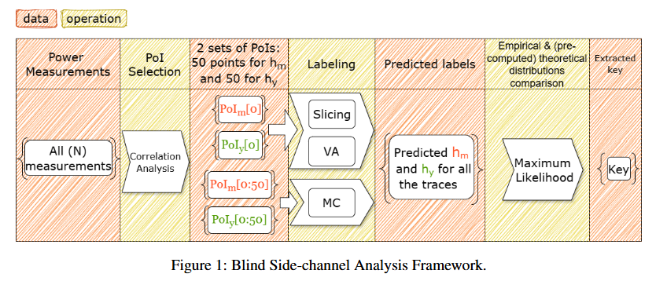
*Figure 1: Blind Side-channel Analysis Framework.*

#### 2.3 Gaussian Mixture Model

이 논문에서는 다중 포인트 클러스터 기반(MC) 라벨링 기법에 가우시안 혼합 모델(Gaussian Mixture Model, GMM) 이라는 클러스터링 기법을 사용한다.

**GMM 클러스터링 기법**

데이터가 여러 가우시안 분포의 조합으로 표현될 수 있다고 가정하는 확률적 방법.

부채널 측정값의 노이즈가 일반적으로 가우시안 분포로 근사될 수 있기 때문에 종종 유효하다.

GMM을 적용할 때는 먼저 생성할 클러스터 수를 정한다. 그런 다음 각 클러스터의 평균, 공분산, 혼합 계수를 초기화하고 기댓값-최대화(Expectation-Maximization, EM) 알고리즘을 반복 적용해 매개변수를 정제한다.

EM 알고리즘은 두 가지 주요 단계로 작동한다.

**1. 기댓값 단계(Expectation Step)**

모델의 현재 매개변수 추정치가 주어졌을 때, 각 데이터 포인트가 각 가우시안 분포에 속할 확률을 계산.

**2. 최대화 단계(Maximization Step)**

이러한 확률 추정치가 주어졌을 때, 데이터의 기대 우도를 최대화하도록 매개변수(평균, 공분산, 혼합 계수)를 업데이트.

모델이 수렴하거나 지정된 반복 횟수에 도달할 때까지 두 단계를 반복하며, 이를 통해 GMM 클러스터링 방법이 클러스터를 생성하기 위한 매개변수 세트를 제공한다.

MC 라벨링 방법에서 이 접근 방식(GMM)을 사용한다.

### 3 Deep Learning-based Blind Side-channel Attacks

#### 3.1 Threat Model

이 연구에서는 위협 모델을 아래와 같이 정의했다.

- 공격자는 처리 중인 데이터(평문이나 암호문 등)에 대한 사전 지식이 없으며, 비밀 키를 추론하기 위해 오직 SCA 측정값에만 의존해야 한다.
- 공격자가 가장 정보량이 많은 PoI에 대한 지식을 가지고 있다고 가정한다. (관련 PoI는 측정값과 대상 변수의 실제 해밍 가중치 간의 상관관계를 분석하여 얻는다.)

#### 3.2 Methodology

#### 문제 정의

블라인드 SCA 프레임워크 내에서 가장 큰 문제는 트레이스에 라벨을 지정하는 것이며, 잘못 라벨링된 트레이스가 너무 많으면 공격은 실패할 것이다.

#### 관찰

DNN은 잘못 라벨링된 데이터가 있더라도 보지 못한 데이터에 대해 일반화되는 것으로 나타났다.

#### 제안

블라인드 SCA에서 DNN의 능력을 활용하기 위해, 딥러닝 기반 블라인드 사이드 채널 분석(DL-BSCA) 프레임워크를 제안한다.

#### 수정

DL-BSCA 은 section 2.2에 개략적으로 설명된 동일한 세 단계로 구성된다.수정 사항은 2단계*( 경험적 분포를 얻기 위한 트레이스 라벨링 )*에만 이루어졌다.

트레이스를 라벨링하고 경험적 분포를 얻기 위해, 2단계를 세 개의 하위 단계로 나누게 된다.

**2. 경험적 분포를 얻기 위한 트레이스 라벨링**

- (a) PoI 선택.
- (b) 트레이스의 일부에 라벨을 지정하고 이를 사용하여 DNN을 학습.
- (c) DNN을 사용하여 나머지 트레이스의 라벨을 예측하고 경험적 분포를 획득.

DL-BSCA는 트레이스를 두 개의 세트로 분할

**학습 트레이스(training traces) :** 특정 라벨링 기법을 사용하여 라벨이 지정

**공격 트레이스(attack traces) :** 학습된 DNN을 통과시켜 경험적 분포를 얻음.

라벨링 기법으로 인해 많은 트레이스에 잘못된 라벨이 지정될 수 있으므로, DL-BSCA는 노이즈가 있는 라벨(noisy labels)로 DNN을 학습시킨다.

#### 3.3 Multi-point Cluster-based Labeling

각각 HW(m)과 HW(y)에 대해 하나의 PoI(Point of Interest)만을 고려하는 Slicing 라벨링 및 VA 라벨링과 달리 MC 라벨링은 HW(m)에 대해 50개의 PoI를, HW(y)에 대해 또 다른 50개의 PoI를 취한다. 선택한 POI는 각각 HW(m) 및 HW(y)와 가장 높은 상관관계를 갖는 상위 50개의 샘플 포인트로 선택된다.

HW(m)을 위해 선택된 50개의 PoI를 PoI_m으로, HW(y)를 위해 선택된 다른 50개의 PoI를 PoI_y로 둔다.

MC 라벨링은 클러스터 생성(Produce Clusters)과 라벨 제공(Provide Labels)의 두 단계로 실행된다.

**클러스터 생성**100개의 샘플 포인트를 가진 절단된 트레이스가 클러스터링 기법에 입력 됨.

 PoI_m과 PoI_y의 샘플 포인트를 기반으로 트레이스를 별도로 클러스터링을 한다면, m과 y사이의 관계에 대한 정보를 잃게 될 것이기 때문에 두 샘플 포인트 세트를 모두 함께 고려하여 트레이스를 클러스터링하고, 동일한 HW(y)와 HW(m)을 가진 트레이스를 하나의 클러스터로 묶는다.

이 때, 클러스터링 기법들과 비교했을 때 가장 성공적이라고 판단된 GMM을 클러스터링 기법을 사용한다.

그림 3은 MC 라벨링 과정에서의 클러스터 생성 단계를 보여주다.

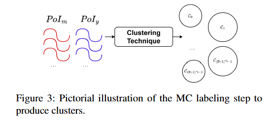
*Figure 3: Pictorial illustration of the MC labeling step to produce clusters.*

**라벨 제공**  
클러스터링 과정은 유사성에 따라 트레이스를 그룹화하지만, 클러스터에는 여전히 라벨이 없으므로, 각 클러스터 C를 연관된 라벨 Y^{(m)}_C, Y^{(y)}_C)에 아래의 방법으로 매핑한다.

1. 각 클러스터의 중심을 계산한다.
2. 중심을 PoI_m 부분과 PoI_y 부분으로 나눈다.
3. PoI_m의 각 샘플 위치에 slicing labeling을 적용한다.
4. 가중 다수결로 각 클러스터의 m 레이블을 하나로 정한다.
5. 같은 방법으로 y 레이블을 정하고, 클러스터 안의 모든 트레이스에 부여한다

MC 라벨링은 두 변수 hm과 hy에 대한 해밍 가중치를 예측하며, 세 개 이상의 변수에 대한 해밍 가중치를 예측하도록 일반화될 수 있다. 또한 MC 라벨링은 이전 연구에서 제안된 블라인드 SCA와 직접 사용함으로 모든 트레이스에 라벨을 지정하고 경험적 분포를 얻을 수 있다.

MC 라벨링은 DL_BSCA와 결합되어 DNN 학습 트레이스를 라벨링하는 데 사용된다.

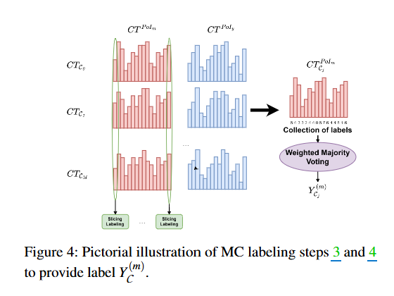
*Figure 4: Pictorial illustration of MC labeling steps 3 and 4 to provide label Y^{(m)}_C*

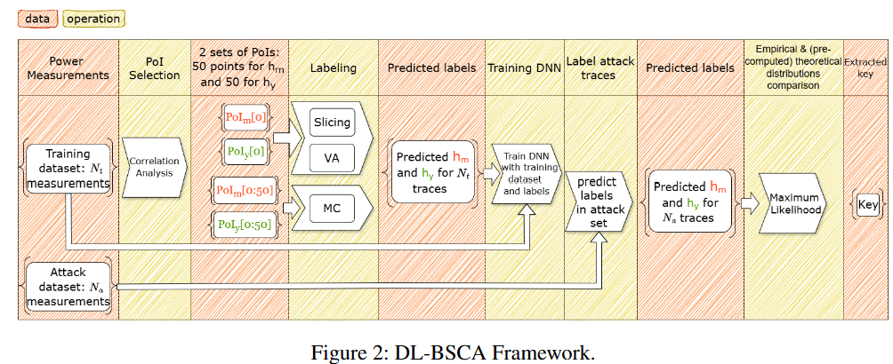
*Figure 2: DL-BSCA Framework*

### 4. Experimental Setup and Results

#### 4.1 Neural Networks and Hyperparameter Search Space

이전 연구에서 보고된 범위를 기반으로 아래의 표 8에 나열된 범위에서 서로 다른 하이퍼파라미터를 선택하여 무작위로 샘플링한다.

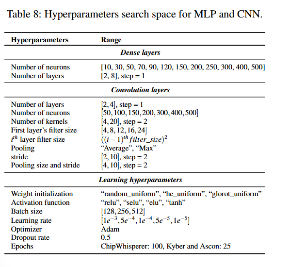
*Table 8: Hyperparameters search space for MLP and CNN.*

정규화 기법을 사용하는 것이 노이즈가 있는 레이블 및 딥러닝 기반 SCA 환경에서 신경망의 일반화 성능을 유지하는 데 도움이 된다는 점이 입증되어서, 드롭아웃을 사용하는 경우와 드롭아웃 정규화를 사용하지 않는 경우, 두 가지 시나리오에 대한 결과를 정리했다.

고려된 각 데이터셋에 대해 최적의 네트워크를 찾기 위해 100개의 서로 다른 모델을 무작위로 샘플링했다.

딥러닝 기반 SCA에서 널리 성공적으로 사용되어 온 CNN과 MLP라는 두 가지 유형의 아키텍처를 고려했다. DNN을 학습시킬 때는 범주형 교차 엔트로피(categorical cross-entropy)를 사용한다.

레이블이 튜플(hm, hy)로 저장되는 경우, 학습을 위해 단일 입력 및 단일 출력 DNN을 용이하게 하려면 변환이 필요하며, 이를 해결하기 위해 (B + 1) ∗ hm + hy를 통해 튜플을 단일 값으로 변환한다.

#### 4.2 Chipwhisperer

ChipWhisperer (CW) 데이터셋은 ChipWhisperer CW308 UFO 보드에 탑재된 8비트 XMEGA에서 실행되는 보호되지 않은 AES 소프트웨어 구현의 측정값을 제공.  

**Dataset**

- 데이터셋은 고정 키를 사용하는 10,000개의 트레이스로 구성된다.
- 각 트레이스에는 5,000개의 샘플 포인트가 포함되어 있다.
- 레이블링 및 DNN 학습에는 Nt = 8,000개의 트레이스를 사용하고, 공격에는 Na = 2,000개의 트레이스를 사용한다.
- 추측 엔트로피(Guessing Entropy, GE) 값은 공격 세트에서 1,700개의 무작위 트레이스를 사용하여 공격을 100회 반복한 평균값이다.
- 고전적인 블라인드 SCA의 경우, 레이블링 및 공격에 N = 8,000개의 트레이스를 사용한다.

CW 데이터셋에 기존 연구들의 방법을 적용하였으나, 비교적 높은 SNR에도 불구하고 비밀 키를 복구할 수 없었다. DNN을 사용하지 않은 MC 라벨링 또한 완전한 복구가 이루어지지는 않았다. (그림 5 참고)

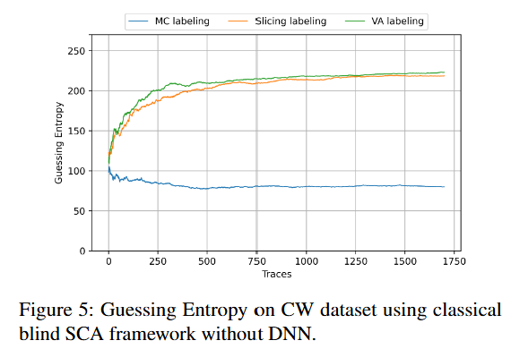
*Figure 5: Guessing Entropy on CW dataset using classical blind SCA framework without DN*

표 2 는 CW데이터 셋에 대한 성능을 표로 정리한 것으로 성공적인 공격은 파란색으로 강조되어 있다.

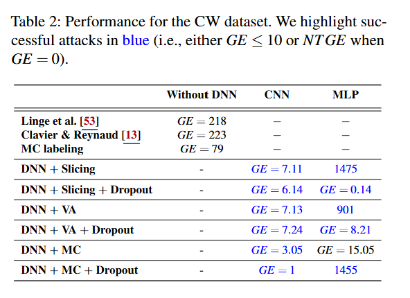
*Table 2: Performance for the CW dataset. We highlight successful attacks in blue (i.e., either GE ≤ 10 or NT GE when GE = 0).*

그림6, 그림7은 VA 라벨링을 적용한 DL-BSCA 프레임워크에서 딥러닝을 CNN, MLP를 사용했을때 트레이스 수 별,  공격 성공률(GE)를 나타낸 그래프이다.

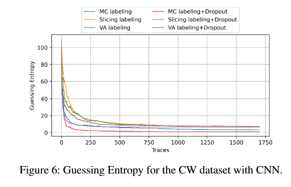
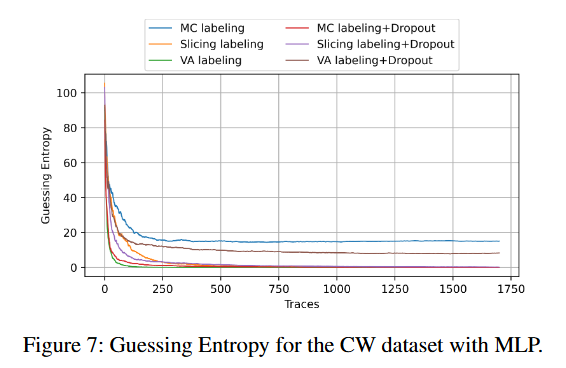
*Figure 6: Guessing Entropy for the CW data / Figure 7: Guessing Entropy for the CW dat*

**Experimental Results for the CW Dataset**

DL-BSCA를 사용할 때, MC labeling을 적용한 MLP를 제외한 모든 경우에서 GE가 10 미만으로 수렴했으며, 이전 연구와 비교하여 DL-BSCA의 효율성을 보여주는 결과이다.

#### 4.3 Kyber

CRYSTAL-Kyber는 NIST가 양자 내성 암호(PQC) 애플리케이션을 위해 선정한 키 캡슐화 메커니즘(KEM)의 표준으로 이 연구에서는 보안수준3인 Kyber768 (k=3,n=256,q=3329k=3,n=256,q=3329) 대상으로 DL-BSCA 프레임워크를 통해 Decapsulation(sk, c) 절차로부터 비밀 키를 복구하는 데 집중한다.

알고리즘1은 kyber의 복호화 알고리즘으로 복호화알고리즘 4번째 줄 빨간색 부분 연산을 타겟으로 한다.

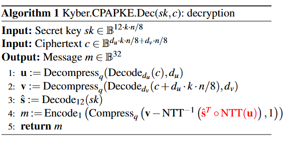
*Algorithm 1*

**Dataset**

- 32비트 ARM Cortex-M4 마이크로컨트롤러에서 PQC 체계를 벤치마킹하고 테스트하기 위한 프레임워크인 pqm4 라이브러리에서 가져온 Kyber KEM의 참조 구현을 기반으로 한다.
- 트레이스는 ChipWhisperer CW308 설정을 사용하여 7.372 MHz로 구동되는 STM32F3 마이크로컨트롤러에서 캡처되었다.
- 측정값은 500 × 10⁶ 샘플/초의 샘플링 속도로 Lecroy 610Zi 오실로스코프를 사용하여 수집되었다.
- 고정된 비밀 키로 100,000개의 트레이스를 캡처했으며, 원래 데이터셋에서 각 트레이스는 50,000개의 시간 샘플을 포함한다.
- 데이터셋의 샘플 수를 줄이기 위해, 이전 연구에서 효과적인 것으로 입증된 윈도우 리샘플링 기법을 사용했다. 윈도우 리샘플링 후 최종 트레이스는 각각 10,000개의 샘플을 가진다.

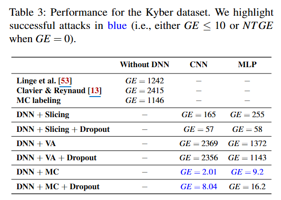
*Table 3: Performance for the Kyber dataset. We highlight successful attacks in blue (i.e., either GE ≤ 10 or NT GE when GE = 0).*

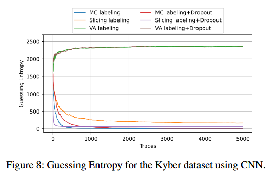
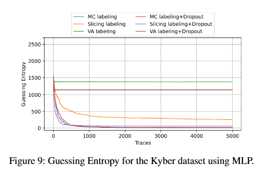
*Figure 8: Guessing Entropy for the Kyber dataset using CNN. / Figure 9: Guessing Entropy for the Kyber dataset using MLP.*

**Experimental Results for the Kyber**  
DNN을 사용한 MC 라벨링만이 GE를 10 미만의 값으로 낮출 수 있었음을 보여, Kyber 데이터셋에서 MC 라벨링이 우수한 성능을 보임을 확인했다.

#### 4.4 Ascon

ASCON은 CEASAR 및 NIST 경량 암호화 공모전의 우승자로, 현재 광범위한 공공 사용을 위해 표준화되고 있습니다.스펀지 구조를 기반으로 하는 인증 암호화 알고리즘으로 메시지의 기밀성을 유지하면서 동시에 무결성을 제공하기 위해 메시지를 암호화한다.  

**Dataset**

- ASCON 데이터셋은 이전 연구에서 얻은 공개 데이터셋으로 트레이스는 ChipWhisperer Lite 보드와 타겟 마이크로컨트롤러는 7.37 MHz의 기본 클록 주파수에서 작동하는 32비트 플랫폼인 STM32F4 타겟에 연결된 8비트 정밀 오실로스코프를 사용하여 캡처되었다.
- 트레이스는 소프트웨어 구현으로 보호되지 않은 초기화 순열의 첫 번째 라운드에서만 전력 샘플을 포함하도록 기록되었다.
- 데이터셋은 각각 772개의 샘플을 포함하는 200,000개의 트레이스로 구성되며, 마지막 100,000개의 트레이스는 고정 키를 사용하여 수집고, 본 연구에서는 이것만을 사용한다.
- Nt = 80,000개의 트레이스는 학습용으로 사용되며, 나머지 Na = 20,000개는 공격 트레이스로 사용된다.
- 추측 엔트로피(Guessing Entropy, GE) 값은 공격 세트에서 무작위로 선택된 5,000개의 트레이스를 사용하여 공격을 100회 반복한 평균값으로 고전적인 블라인드 SCA 프레임워크를 사용하는 방법의 경우, N = 80,000개의 트레이스를 사용한다.

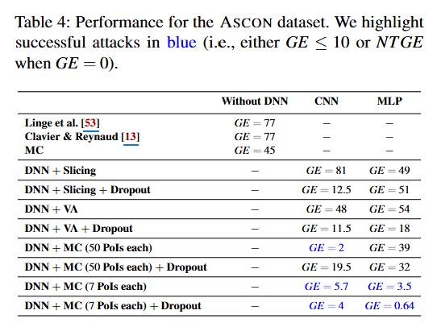
*Table 4: Performance for the ASCON dataset. We highlight successful attack*

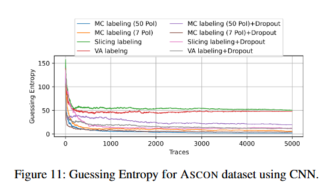
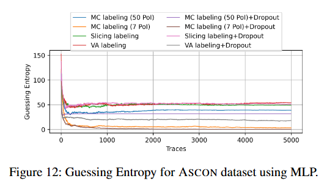
*Figure 11: Guessing Entropy for ASCON dataset using CNN. / Figure 12: Guessing Entropy for ASCON dataset using MLP.*

**Experimental Results for ASCON**

- ASCON 구현에 DL-BSCA를 적용하는 것은 논스 m0와 m1, 그리고 Sbox 출력 y4라는 세 가지 변수로 프레임워크를 확장해야 한다.
- 두 방법론을 모두 적용하였으나, 실질적으로 비밀 키를 복구할 수 없었다. (Table 4 참조)
- DL-BSCA를 사용할 때 MC 라벨링과 결합된 CNN을 제외하고는 비밀 키를 복구할 수 없었고, 이러한 저조한 성능은 y, m0, m1의 누설이 여러 샘플 지점에서 중첩되어, 훨씬 더 많은 오라벨링된 트레이스가 발생했기 때문일 수 있다.

**Targeting Countermeasures: Desynchronized CW Dataset.**

- 이전의 블라인드 SCA 접근 방식은 각 변수에 대해 단일 PoI를 선택했다.
- 트레이스의 정렬을 방해하는 비동기화(desynchronization)와 같은 은닉 대응책은 공격자가 단일 관련 PoI를 선택하지 못하도록 하기 때문에 이전의 블라인드 SCA 방법들은 비동기화(또는 기타 은닉) 대응책에 적용된 적이 없다.
- DL-BSCA 프레임워크는 변수당 50개의 PoI를 고려하며, DNN이 비동기화를 처리하는 능력은 선행 연구들에서 이미 입증되었다.

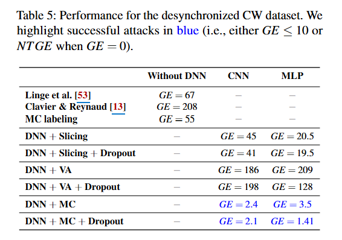
*Table 5: Performance for the desynchronized CW dataset. We highlight successful attacks in blue (i.e., either GE ≤ 10 or NT GE when GE = 0).*

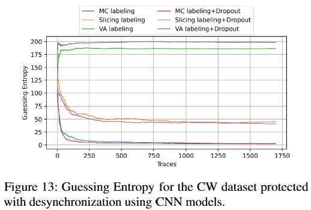
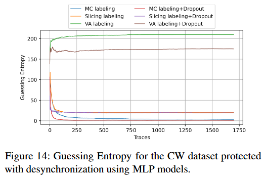
*Figure 13: Guessing Entropy for the CW dataset protected with desynchronization using CNN models. / Figure 14: Guessing Entropy for the CW dataset protected with desynchronization using MLP models.*

Slicing과 VA 라벨링을 모두 사용할 경우 GE > 10 이며, DL-BSCA와 MC 라벨링을 함께 사용하는 시나리오에서는 GE < 4를 얻을 수 있다. 즉, DNN을 사용하지 않으면 비밀 키를 복구할 수 없다.

이는 비동기화가 데이터셋을 보호하는 데 사용되는 경우에도 DL-BSCA 프레임워크와 MC 라벨링이 비밀 키를 복구하는 데 효과적임을 보여준다. 이는 이전에 불가능하다고 여겨졌던 블라인드 SCA 영역에서 비동기화된 타겟에 대한 실행 가능한 공격이 처음으로 입증된 사례이다.

#### 5 Discussion

그림 15는 MLP 학습에 사용된 잘못 레이블링된 데이터의 비율이 키 복구 성능에 어떤 영향을 미치는지 나타낸다.

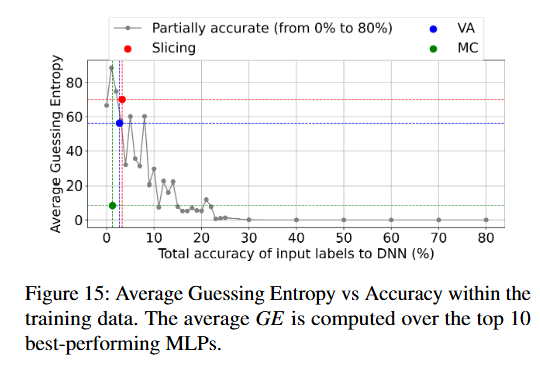
*Figure 15: Average Guessing Entropy vs Accuracy within the training data. The average GE is computed over the top 10 best-performing MLPs.*

그림 16은 다양한 레이블링 기법을 적용할 때 HW(m)의 각 클래스에 대한 정확도를 나태낸 그래프이다.

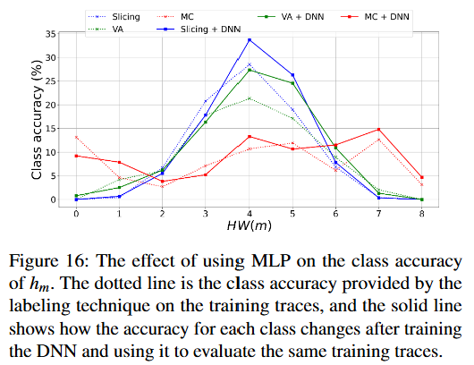
*Figure 16: The effect of using MLP on the class accuracy of hm. The dotted line is the class accuracy provided by the labeling technique on the training traces, and the solid line shows how the accuracy for each class changes after training the DNN and using it to evaluate the same training traces*

표 6은 다중 PoI를 사용하는 것이 DL-BSCA의 성능에 어떤 영향을 끼치는지 나타낸 표이다.

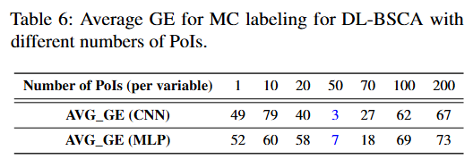
*Table 6: Average GE for MC labeling for DL-BSCA with different numbers of PoIs.*

**Limitations**

이 논문에서는 아래 두가지를 한계 및 향후 연구 과제로 제안한다.

- 완전 블라인드 선택에서의 PoI 선택.
- 실제 환경에서 마스킹된 구현체를 BSCA로 공격하는 것.

### 6 Related Work

기존 연구의 모든 블라인드 SCA 접근 방식은 단 하나의 PoI만을 활용했다.  
결과적으로 이러한 방법들은 누설의 시간적 정렬을 모호하게 함으로써 추가적인 문제를 야기하는 비동기화(desynchronization)와 같은 하이딩(hiding) 대응책에 대해서는 본질적으로 효과적이지 않았고, 본 논문에서 제안하는 방법들은 딥러닝을 활용하여 기존 블라인드 SCA의 주요 한계점들을 해결했다.

본 연구의 접근 방식은 다양한 플랫폼, 암호 알고리즘 및 대응책에 대해 블라인드 SCA를 성공적으로 입증하였으며, 실제 실험을 통해 검증되었으며, 이는 블라인드 SCA의 실용적 적용 가능성을 크게 향상시켰다.

표 7은 기존 블라인드 SCA와 제안한 DL_BSCA를 비교한다.

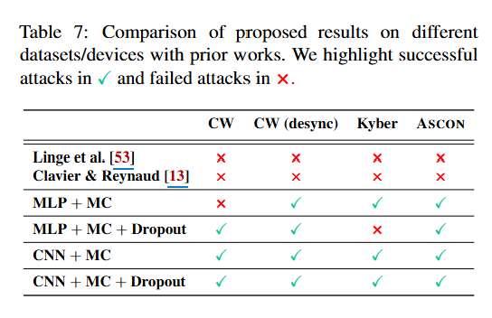
*Table 7: Comparison of proposed results on different datasets/devices with prior works. We highlight successful attacks in ✓ and failed attacks in ×.*

### 7 Conclusions and Future Work

#### 결론

- 딥러닝 기반 블라인드 부채널 분석을 위한 새로운 프레임워크인 DL-BSCA를 제안.
- DL-BSCA는 딥러닝의 성능을 활용하여 노이즈가 많은 데이터셋을 효과적으로 처리하여 블라인드 SCA의 핵심 과제들을 해결한다.
- 다양한 플랫폼 전반에 걸쳐 성공적인 공격을 시연.
- 대칭 키 및 양자 내성 암호 알고리즘의 실제 측정값으로 구성된 4개의 데이터셋에서 접근 방식을 검증.
- MC 레이블링 방법을 통해 누설 지점이 겹치지 않는 시나리오에서 이전 기법들보다 뛰어난 성능을 보인다.
- 비동기화와 같은 하이딩 대응책에 대한 최초의 성공적인 블라인드 SCA이며, DL-BSCA 프레임워크의 범용성을 입증.

#### 한계

- 약한 마스킹을 고려하한 시뮬레이션 트레이스로만 실험.
- 공격자가 PoI를 찾을 수 있다고 가정.

### 8 Ethical Considerations

법률을 준수했다는 내용이 있다.

### 9 Open Science Policy

연구를 수행하는 데 사용된 코드와 데이터셋의 최신 버전은 아래 링크를 통해 확인할 수 있다.

[Breaking the Blindfold: Deep Learning-based Blind Side-channel Analysis](https://zenodo.org/records/15614359)

## 자료

<https://www.usenix.org/system/files/usenixsecurity25-rezaeezade.pdf>

<https://www.usenix.org/conference/usenixsecurity25/presentation/rezaeezade?utm_source=openai>
