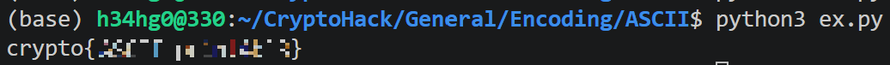
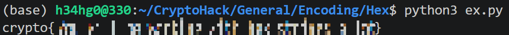
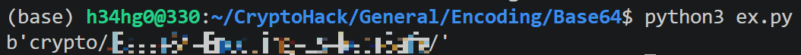
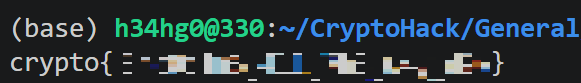
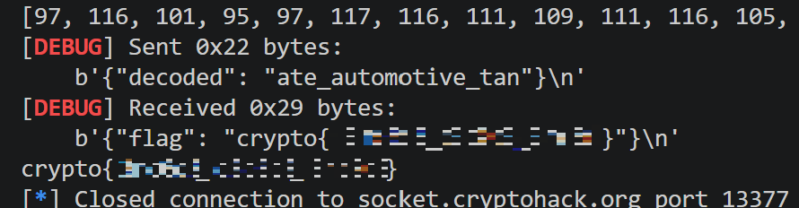

## ASCII

### 원문

ASCII is a 7-bit encoding standard which allows the representation of text using the integers 0-127.  
Using the below integer array, convert the numbers to their corresponding ASCII characters to obtain a flag.  
[99, 114, 121, 112, 116, 111, 123, 65, 83, 67, 73, 73, 95, 112, 114, 49, 110, 116, 52, 98, 108, 51, 125]  
 In Python, the chr() function can be used to convert an ASCII ordinal number to a character (the ord() function does the opposite).

### 번역

ASCII는 0부터 127까지의 정수를 사용하여 텍스트를 표현할 수 있게 해주는 7비트 인코딩 표준입니다.

아래의 정수 배열을 사용하여 각 숫자를 해당하는 ASCII 문자로 변환해 플래그(flag)를 획득하세요.

[99, 114, 121, 112, 116, 111, 123, 65, 83, 67, 73, 73, 95, 112, 114, 49, 110, 116, 52, 98, 108, 51, 125]

파이썬에서는 chr() 함수를 사용하여 ASCII 정수 값을 문자로 변환할 수 있습니다(ord() 함수는 그 반대 역할을 합니다).

### 풀이

주어진 아스키 코드를 파이썬의 chr 함수를 써서 문자로 복원해 하나로 합쳤다. 출력으로 플래그가 나왔다.

#### ex.py

```python
ASCIIS = [99, 114, 121, 112, 116, 111, 123, 65, 83, 67, 73, 73, 95, 112, 114, 49, 110, 116, 52, 98, 108, 51, 125]

flag = ''
for ascii in ASCIIS:
    flag += chr(ascii)

print(flag)
```


*실행결과*

## Hex

### 원문

When we encrypt something the resulting ciphertext commonly has bytes which are not printable ASCII characters. If we want to share our encrypted data, it's common to encode it into something more user-friendly and portable across different systems.  
Hexadecimal can be used in such a way to represent ASCII strings. First each letter is converted to an ordinal number according to the ASCII table (as in the previous challenge). Then the decimal numbers are converted to base-16 numbers, otherwise known as hexadecimal. The numbers can be combined together, into one long hex string.  
Included below is a flag encoded as a hex string. Decode this back into bytes to get the flag.  
63727970746f7b596f755f77696c6c5f62655f776f726b696e675f776974685f6865785f737472696e67735f615f6c6f747d  
 In Python, the bytes.fromhex() function can be used to convert hex to bytes. The .hex() instance method can be called on byte strings to get the hex representation.

### 번역

무언가를 암호화하면, 그 결과로 생성되는 암호문에는 출력 가능한(printable) ASCII 문자가 아닌 바이트가 포함되는 경우가 많습니다. 암호화된 데이터를 공유하고자 할 때는, 다루기 쉽고 서로 다른 시스템 간에도 호환이 잘 되는 형태로 인코딩하는 것이 일반적입니다.  
16진수(Hexadecimal)는 이러한 방식으로 ASCII 문자열을 표현하는 데 사용될 수 있습니다. 먼저 (이전 문제에서와 같이) ASCII 표에 따라 각 문자를 해당하는 정수 값으로 변환합니다. 그런 다음 이 10진수 숫자들을 16진법 숫자, 즉 16진수(hexadecimal)로 변환합니다. 이렇게 변환된 숫자들을 하나로 이어 붙이면 긴 16진수 문자열이 됩니다.  
아래에 16진수 문자열로 인코딩된 플래그가 있습니다. 이를 다시 바이트로 디코딩하여 플래그를 획득하세요.  
63727970746f7b596f755f77696c6c5f62655f776f726b696e675f776974685f6865785f737472696e67735f615f6c6f747d  
파이썬에서는 bytes.fromhex() 함수를 사용하여 16진수를 바이트로 변환할 수 있습니다. 반대로 바이트 문자열에 `.hex()` 인스턴스 메서드를 호출하면 16진수 표현을 얻을 수 있습니다.

### 풀이

주어진 hex값을 bytes.fromhex를 사용해 16진수 바이트로 복원하고 출력하니 플래그가 나왔다.

#### ex.py

```python
Hex = '63727970746f7b596f755f77696c6c5f62655f776f726b696e675f776974685f6865785f737472696e67735f615f6c6f747d'

flag = bytes.fromhex(Hex).decode('utf-8')
print(flag)
```


*flag*

## Base64

### 원문

Another common encoding scheme is Base64, which allows us to represent binary data as an ASCII string using an alphabet of 64 characters. One character of a Base64 string encodes 6 binary digits (bits), and so 4 characters of Base64 encode three 8-bit bytes.  
Base64 is most commonly used online, so binary data such as images can be easily included into HTML or CSS files.  
Take the below hex string, decode it into bytes and then encode it into Base64.  
72bca9b68fc16ac7beeb8f849dca1d8a783e8acf9679bf9269f7bf  
 In Python, after importing the base64 module with import base64, you can use the base64.b64encode() function. Remember to decode the hex first as the challenge description states.

### 번역

또 다른 흔한 인코딩 방식은 Base64로, 64개의 문자로 구성된 문자 집합을 사용해 바이너리 데이터를 ASCII 문자열로 표현할 수 있게 해줍니다. Base64 문자열의 문자 하나는 6개의 이진 자릿수(비트)를 인코딩하므로, Base64의 4개 문자는 3개의 8비트 바이트를 인코딩합니다.  
Base64는 온라인에서 가장 흔히 사용되며, 이를 통해 이미지와 같은 바이너리 데이터를 HTML이나 CSS 파일에 쉽게 포함할 수 있습니다.  
아래의 16진수 문자열을 가져와 바이트로 디코딩한 다음 Base64로 인코딩하세요.  
`72bca9b68fc16ac7beeb8f849dca1d8a783e8acf9679bf9269f7bf`  
파이썬에서는 `import base64`로 `base64` 모듈을 임포트한 후 `base64.b64encode()` 함수를 사용할 수 있습니다. 문제 설명에 명시된 대로 먼저 16진수를 디코딩하는 것을 잊지 마세요.

### 풀이

문제 설명대로 주어진 hex값을 바이트 값으로 변경하고 그 값을 base64 encode하니 플래그가 나왔다.

#### ex.py

```python
from base64 import b64encode
h = '72bca9b68fc16ac7beeb8f849dca1d8a783e8acf9679bf9269f7bf'
b = bytes.fromhex(h)
flag = b64encode(b)
print(flag)
```


*flag*

## Bytes and Big Integers

### 원문

Cryptosystems like RSA works on numbers, but messages are made up of characters. How should we convert our messages into numbers so that mathematical operations can be applied?  
The most common way is to take the ordinal bytes of the message, convert them into hexadecimal, and concatenate. This can be interpreted as a base-16/hexadecimal number, and also represented in base-10/decimal.  
To illustrate:  
message: HELLO  
ascii bytes: [72, 69, 76, 76, 79]  
hex bytes: [0x48, 0x45, 0x4c, 0x4c, 0x4f]  
base-16: 0x48454c4c4f  
base-10: 310400273487  
 Python's PyCryptodome library implements this with the methods bytes_to_long() and long_to_bytes(). You will first have to install PyCryptodome and import it with from Crypto.Util.number import \*. For more details check the FAQ.  
Convert the following integer back into a message:  
11515195063862318899931685488813747395775516287289682636499965282714637259206269

### 번역

RSA와 같은 암호화 시스템은 숫자를 기반으로 작동하지만, 메시지는 문자로 이루어져 있습니다. 수학적 연산을 적용할 수 있도록 메시지를 어떻게 숫자로 변환해야 할까요?  
가장 일반적인 방법은 메시지의 각 문자를 해당하는 바이트 값(정수)으로 변환한 뒤, 이를 16진수로 바꾸어 하나로 이어 붙이는 것입니다. 이렇게 만들어진 값은 16진법(base-16) 숫자로 해석할 수 있으며, 10진법(base-10)으로도 표현할 수 있습니다.  
예를 들면 다음과 같습니다:  
메시지: HELLO  
ASCII 바이트: `[72, 69, 76, 76, 79]`  
16진수 바이트: `[0x48, 0x45, 0x4c, 0x4c, 0x4f]`  
16진법: `0x48454c4c4f`  
10진법: `310400273487`  
파이썬의 PyCryptodome 라이브러리는 `bytes_to_long()` 및 `long_to_bytes()` 메서드를 통해 이 기능을 구현하고 있습니다. 먼저 PyCryptodome을 설치한 뒤 `from Crypto.Util.number import \*`로 임포트해야 합니다. 자세한 내용은 FAQ를 확인하세요.  
다음 정수를 다시 메시지로 변환하세요:  
`11515195063862318899931685488813747395775516287289682636499965282714637259206269`

### 풀이

문제에서 주어진 정수를 pycryptodome 모듈의 long_to_bytes()를 사용해서 바이트로 변환하여 출력하니 플래그가 나왔다.

#### ex.py

```python
from Crypto.Util.number import long_to_bytes

flag = 11515195063862318899931685488813747395775516287289682636499965282714637259206269
print(long_to_bytes(flag).decode())
```


*flag*

## Encoding Challenge

### 원문

Now you've got the hang of the various encodings you'll be encountering, let's have a look at automating it.  
Can you pass all 100 levels to get the flag?  
The 13377.py file attached below is the source code for what's running on the server. The pwntools_example.py file provides the start of a solution.  
For more information about connecting to interactive challenges, see the FAQ. Feel free to skip ahead to the cryptography if you aren't in the mood for a coding challenge!

### 번역

이제 앞으로 마주하게 될 다양한 인코딩 방식에 익숙해졌으니, 이를 자동화하는 방법을 살펴봅시다.  
100단계를 모두 통과해서 플래그를 획득할 수 있을까요?  
아래에 첨부된 `13377.py` 파일은 서버에서 실행 중인 프로그램의 소스 코드입니다. `pwntools_example.py` 파일은 풀이의 시작 부분을 제공합니다.  
대화형 문제에 접속하는 방법에 대한 자세한 내용은 FAQ를 확인하세요. 코딩 문제를 풀 기분이 아니라면 바로 암호학 문제로 건너뛰셔도 좋습니다!

### 풀이

1337.py, pwntools_example.py가 제공된다.

#### 1337.py

```python
#!/usr/bin/env python3

from Crypto.Util.number import bytes_to_long, long_to_bytes
from utils import listener # this is cryptohack's server-side module and not part of python
import base64
import codecs
import random

FLAG = "crypto{????????????????????}"
ENCODINGS = [
    "base64",
    "hex",
    "rot13",
    "bigint",
    "utf-8",
]
with open('/usr/share/dict/words') as f:
    WORDS = [line.strip().replace("'", "") for line in f.readlines()]

class Challenge():
    def __init__(self):
        self.no_prompt = True # Immediately send data from the server without waiting for user input
        self.challenge_words = ""
        self.stage = 0

    def create_level(self):
        self.stage += 1
        self.challenge_words = "_".join(random.choices(WORDS, k=3))
        encoding = random.choice(ENCODINGS)

        if encoding == "base64":
            encoded = base64.b64encode(self.challenge_words.encode()).decode() # wow so encode
        elif encoding == "hex":
            encoded = self.challenge_words.encode().hex()
        elif encoding == "rot13":
            encoded = codecs.encode(self.challenge_words, 'rot_13')
        elif encoding == "bigint":
            encoded = hex(bytes_to_long(self.challenge_words.encode()))
        elif encoding == "utf-8":
            encoded = [ord(b) for b in self.challenge_words]

        return {"type": encoding, "encoded": encoded}

    #
    # This challenge function is called on your input, which must be JSON
    # encoded
    #
    def challenge(self, your_input):
        if self.stage == 0:
            return self.create_level()
        elif self.stage == 100:
            self.exit = True
            return {"flag": FLAG}

        if self.challenge_words == your_input["decoded"]:
            return self.create_level()

        return {"error": "Decoding fail"}

import builtins; builtins.Challenge = Challenge # hack to enable challenge to be run locally, see https://cryptohack.org/faq/#listener
listener.start_server(port=13377)
```

1337.py를 분석해보자면 base64, hex, rot13, bigint, utf-8 인코딩이 랜덤으로 동작된 인코딩 문자열이 주어지며 인코딩이 무엇이 되었는지와 이 인코딩 방식에 올바르게 디코딩 한 값을 제출하는 것을 100번 성공하면 플래그를 받을 수 있다.

이를 동작하는 코드를 제공받은 pwntools_example.py위에 구현하여 플래그를 구했다.

인코딩 종류에 해당하는 디코딩 방법을 사용하여 디코딩된 값을 100번 전달하고 마지막으로 flag를 받아오도록 작성했다.

이때 디코딩에 사용한 모듈과 메서드는 1337.py에 사용된 모듈의 디코딩 메서드를 사용했다.

#### ex.py

```python
from pwn import * # pip install pwntools
import json

from Crypto.Util.number import bytes_to_long, long_to_bytes
import base64
import codecs
import random

r = remote('socket.cryptohack.org', 13377, level = 'debug')

def json_recv():
    line = r.recvline()
    return json.loads(line.decode())

def json_send(hsh):
    request = json.dumps(hsh).encode()
    r.sendline(request)

ENCODINGS = [
    "base64",
    "hex",
    "rot13",
    "bigint",
    "utf-8",
]

def decoder(ENCODING, encoded):
    if ENCODING == "base64":
        return base64.b64decode(encoded).decode()
    elif ENCODING == "hex":
        return bytes.fromhex(encoded).decode()
    elif ENCODING == "rot13":
        return codecs.decode(encoded, 'rot_13')
    elif ENCODING == "bigint":
        return long_to_bytes(int(encoded, 16)).decode()
    elif ENCODING == "utf-8":
        return ''.join([chr(b) for b in encoded])

for i in range(100):
    received = json_recv()

    print("Received type: ")
    print(received["type"])
    print("Received encoded value: ")
    print(received["encoded"])

    to_send = {
        "decoded": decoder(received["type"], received["encoded"])
    }

    json_send(to_send)

received = json_recv()
flag = received["flag"]
print(flag)
```


*flag*
