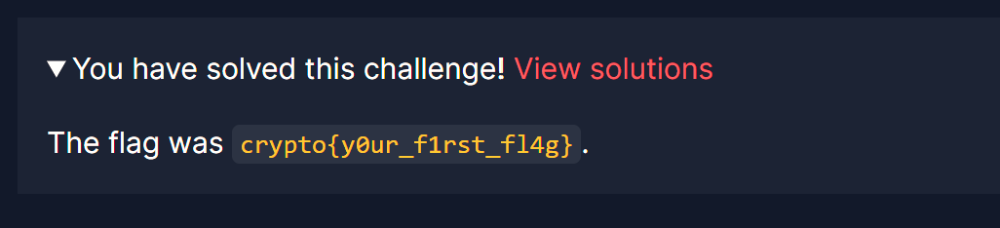
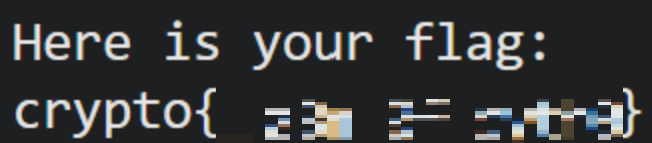
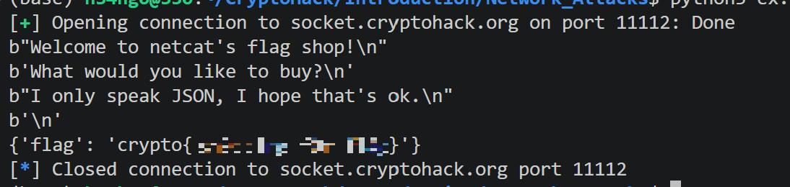

## Finding Flags

### 원문

Each challenge is designed to help introduce you to a new piece of cryptography. Solving a challenge will require you to find a "flag".  
These flags will usually be in the format crypto{y0ur_f1rst_fl4g}. The flag format helps you verify that you found the correct solution.  
Try submitting this flag into the form below to solve your first challenge.

### 번역

각 챌린지는 여러분이 새로운 암호학 개념을 익힐 수 있도록 설계되었습니다. 챌린지를 풀려면 "플래그(flag)"를 찾아야 합니다.

이 플래그는 보통 crypto{y0ur_f1rst_fl4g} 형식으로 되어 있습니다. 이 플래그 형식을 통해 정답을 올바르게 찾았는지 확인할 수 있습니다.

첫 번째 챌린지를 해결하기 위해 아래 양식에 이 플래그를 제출해 보세요.

### 풀이

문제에 플래그가 적혀있어서 제출했다.


*crypto{y0ur_f1rst_fl4g}*

## Great Snakes

### 원문

Each challenge is designed to help introduce you to a new piece of cryptography. Solving a challenge will require you to find a "flag".  
These flags will usually be in the format crypto{y0ur_f1rst_fl4g}. The flag format helps you verify that you found the correct solution.  
Try submitting this flag into the form below to solve your first challenge.

### 번역

각 챌린지는 여러분이 새로운 암호학 개념을 접할 수 있도록 설계되었습니다. 챌린지를 해결하려면 "플래그(flag)"를 찾아야 합니다.

이러한 플래그는 보통 crypto{y0ur_f1rst_fl4g} 형식으로 되어 있습니다. 플래그 형식을 통해 올바른 정답을 찾았는지 확인할 수 있습니다.

첫 번째 챌린지를 완료하려면 아래 입력 양식에 이 플래그를 제출해 보세요.

### 풀이

제공 파일은 아래와 같다.

#### great_snakes.py

```python
#!/usr/bin/env python3

import sys
# import this

if sys.version_info.major == 2:
    print("You are running Python 2, which is no longer supported. Please update to Python 3.")

ords = [81, 64, 75, 66, 70, 93, 73, 72, 1, 92, 109, 2, 84, 109, 66, 75, 70, 90, 2, 92, 79]

print("Here is your flag:")
print("".join(chr(o ^ 0x32) for o in ords))
```

문제에서 제공하는 위 코드를 실행하니 플래그가 나왔다.


*flag*

## Network Attacks

### 원문

Several of the challenges are dynamic and require you to talk to our challenge servers over the network. This allows you to perform man-in-the-middle attacks on people trying to communicate, or directly attack a vulnerable service. To keep things consistent, our interactive servers always send and receive JSON objects.  
Such network communication can be made easy in Python with the pwntools module. This is not part of the Python standard library, so needs to be installed with pip using the command line pip install pwntools.  
For this challenge, connect to socket.cryptohack.org on port 11112. Send a JSON object with the key buy and value flag.

### 번역

여러 챌린지들은 동적으로 작동하며 네트워크를 통해 저희 챌린지 서버와 통신해야 합니다. 이를 통해 통신을 시도하는 대상에게 중간자 공격(man-in-the-middle attack)을 수행하거나, 취약한 서비스를 직접 공격해 볼 수 있습니다. 일관성을 유지하기 위해, 저희의 대화형 서버는 항상 JSON 객체 형식으로 데이터를 주고받습니다.

이러한 네트워크 통신은 Python의 pwntools 모듈을 사용하면 쉽게 구현할 수 있습니다. 이 모듈은 Python 표준 라이브러리에 포함되어 있지 않으므로, 커맨드 라인에서 pip install pwntools 명령어를 입력해 pip로 설치해야 합니다.

이번 챌린지를 해결하려면 socket.cryptohack.org의 11112 포트로 접속하세요. 그런 다음 키(key)는 buy, 값(value)은 flag로 설정된 JSON 객체를 전송하세요.

### 풀이

제공 파일은 아래와 같다.

#### pwntools_example.py

```python
#!/usr/bin/env python3

from pwn import * # pip install pwntools
import json

HOST = "socket.cryptohack.org"
PORT = 11112

r = remote(HOST, PORT)

def json_recv():
    line = r.readline()
    return json.loads(line.decode())

def json_send(hsh):
    request = json.dumps(hsh).encode()
    r.sendline(request)

print(r.readline())
print(r.readline())
print(r.readline())
print(r.readline())

request = {
    "buy": "clothes"
}
json_send(request)

response = json_recv()

print(response)
```

위 코드를 실행하면 아래와 같은 결과가 나온다.

문제 설명에 맞게 주어진 문제 코드의 json의 buy의 value를 flag로 수정하고 실행했더니 flag가 출력되었다.

#### ex.py

```python
#!/usr/bin/env python3

from pwn import * # pip install pwntools
import json

HOST = "socket.cryptohack.org"
PORT = 11112

r = remote(HOST, PORT)

def json_recv():
    line = r.readline()
    return json.loads(line.decode())

def json_send(hsh):
    request = json.dumps(hsh).encode()
    r.sendline(request)

print(r.readline())
print(r.readline())
print(r.readline())
print(r.readline())

request = {
    "buy": "flag"
}
json_send(request)

response = json_recv()

print(response)
```


*flag*
