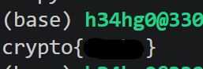
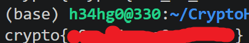
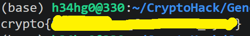
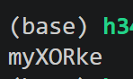
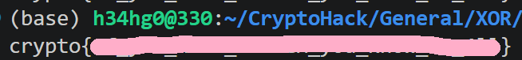
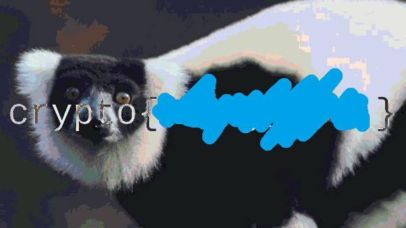

## XOR Starter

### 원문

XOR is a bitwise operator which returns 0 if the bits are the same, and 1 otherwise. In textbooks the XOR operator is denoted by ⊕, but in most challenges and programming languages you will see the caret ^ used instead.  
A B Output  
0 0 0  
0 1 1  
1 0 1  
1 1 0  
For longer binary numbers we XOR bit by bit: 0110 ^ 1010 = 1100. We can XOR integers by first converting the integer from decimal to binary. We can XOR strings by first converting each character to the integer representing the Unicode character.

Given the string label, XOR each character with the integer 13. Convert these integers back to a string and submit the flag as crypto{new_string}.  

 The Python pwntools library has a convenient xor() function that can XOR together data of different types and lengths. But first, you may want to implement your own function to solve this.

### 번역

XOR은 두 비트가 같으면 0을, 다르면 1을 반환하는 비트 연산자입니다. 교과서에서는 XOR 연산자를 ⊕로 표기하지만, 대부분의 문제와 프로그래밍 언어에서는 대신 캐럿 기호(`^`)가 사용되는 것을 보게 될 것입니다.  

A B 출  
0 0 0  
0 1 1  
1 0 1  
1 1 0  

길이가 더 긴 이진수의 경우 비트 단위로 XOR 연산을 수행합니다: `0110 ^ 1010 = 1100`. 정수를 XOR 연산하려면 먼저 10진수 정수를 이진수로 변환합니다. 문자열을 XOR 연산하려면 먼저 각 문자를 해당 유니코드 문자를 나타내는 정수로 변환합니다.  

주어진 문자열 `label`의 각 문자를 정수 `13`과 XOR 연산하세요. 이 정수들을 다시 문자열로 변환한 뒤 `crypto{new_string}` 형식으로 플래그를 제출하세요.  

파이썬의 pwntools 라이브러리에는 서로 다른 타입과 길이를 가진 데이터를 함께 XOR 연산할 수 있는 편리한 `xor()` 함수가 있습니다. 하지만 먼저 직접 함수를 구현하여 이 문제를 해결해 보시는 것을 권장합니다.

### 풀이

"label"의 각 문자 'l', 'a', 'b', 'e', 'l' 을 chr 함수를 사용해 아스키 코드로 변환하고 13과 XOR 연산 후, 다시 ord 함수를 통해 문자열로 복원하면, 복원한 문자열이 플래그라는 것을 문제에서 언급하고 있다. ex.py를 통해 flag를 구하면 다음과 같다.

#### ex.py

```python
enc = 'label'

flag = ''
for c in enc:
    flag += chr(ord(c) ^ 13)
print(f"crypto{{{flag}}}")
```


*flag*

## XOR Properties

### 원문

In the last challenge, you saw how XOR worked at the level of bits. In this one, we're going to cover the properties of the XOR operation and then use them to undo a chain of operations that have encrypted a flag. Gaining an intuition for how this works will help greatly when you come to attacking real cryptosystems later, especially in the block ciphers category.  

There are four main properties we should consider when we solve challenges using the XOR operator  

Commutative: A ⊕ B = B ⊕ A  
Associative: A ⊕ (B ⊕ C) = (A ⊕ B) ⊕ C  
Identity: A ⊕ 0 = A  
Self-Inverse: A ⊕ A = 0  

Let's break this down. Commutative means that the order of the XOR operations is not important. Associative means that a chain of operations can be carried out without order (we do not need to worry about brackets). The identity is 0, so XOR with 0 "does nothing", and lastly something XOR'd with itself returns zero.  

Let's put this into practice! Below is a series of outputs where three random keys have been XOR'd together and with the flag. Use the above properties to undo the encryption in the final line to obtain the flag.  

KEY1 = a6c8b6733c9b22de7bc0253266a3867df55acde8635e19c73313  
KEY2 ^ KEY1 = 37dcb292030faa90d07eec17e3b1c6d8daf94c35d4c9191a5e1e  
KEY2 ^ KEY3 = c1545756687e7573db23aa1c3452a098b71a7fbf0fddddde5fc1  
FLAG ^ KEY1 ^ KEY3 ^ KEY2 = 04ee9855208a2cd59091d04767ae47963170d1660df7f56f5faf  

 Before you XOR these objects, be sure to decode from hex to bytes.

### 번역

이전 문제에서는 비트 단위에서 XOR이 어떻게 작동하는지 살펴보았습니다. 이번 문제에서는 XOR 연산의 성질들을 다룬 다음, 이를 활용해 플래그를 암호화한 일련의 연산들을 되돌려 보겠습니다. 이 원리에 대한 직관을 익혀두면 나중에 실제 암호 시스템, 특히 블록 암호 카테고리의 문제들을 공격할 때 큰 도움이 될 것입니다.

XOR 연산자를 사용하는 문제를 풀 때 고려해야 할 네 가지 주요 성질이 있습니다.

교환법칙(Commutative): A ⊕ B = B ⊕ A

결합법칙(Associative): A ⊕ (B ⊕ C) = (A ⊕ B) ⊕ C

항등원(Identity): A ⊕ 0 = A

자기역원(Self-Inverse): A ⊕ A = 0

하나씩 자세히 살펴봅시다. 교환법칙은 XOR 연산의 순서가 중요하지 않다는 것을 의미합니다. 결합법칙은 일련의 연산을 순서에 상관없이 수행할 수 있다는 뜻입니다(괄호를 신경 쓸 필요가 없습니다). 항등원은 0이므로, 0과 XOR 연산을 하면 "아무 변화도 일어나지 않으며", 마지막으로 어떤 값을 자기 자신과 XOR 연산하면 0이 반환됩니다.

이제 실전에 적용해 봅시다! 아래는 세 개의 무작위 키가 서로 XOR 연산되고 플래그와도 XOR 연산된 일련의 출력값입니다. 위의 성질들을 이용해 마지막 줄의 암호화를 되돌려 플래그를 획득하세요.

KEY1 = a6c8b6733c9b22de7bc0253266a3867df55acde8635e19c73313

KEY2 ^ KEY1 = 37dcb292030faa90d07eec17e3b1c6d8daf94c35d4c9191a5e1e

KEY2 ^ KEY3 = c1545756687e7573db23aa1c3452a098b71a7fbf0fddddde5fc1

FLAG ^ KEY1 ^ KEY3 ^ KEY2 = 04ee9855208a2cd59091d04767ae47963170d1660df7f56f5faf

이 값들을 XOR 연산하기 전에, 반드시 16진수에서 바이트로 디코딩해야 합니다.

### 풀이

주어진 값들을 통해 FLAG를 구하면 된다.

XOR은 같은 값을 XOR 하면 그 값은 연산에서 사라지므로 맨 마지막 값인 FLAG ^ KEY1 ^ KEY3 ^ KEY2에  KEY1 ^ KEY3 ^ KEY2 를 XOR 해주면 된다.

놀랍게도 KEY1과 KEY2 ^ KEY3를 알고있으므로 KEY1 ^ (KEY2 ^ KEY3)을 구할 수 있고 결합법칙과 교환법칙에 의해

KEY1 ^ (KEY2 ^ KEY3) = KEY1 ^ KEY3 ^ KEY2 이다.

즉 이 값을 FLAG ^ KEY1 ^ KEY3 ^ KEY2에 XOR 하면 아래의 과정처럼 결합법칙과 역원에 의해 FLAG 값만 남는 것을 알 수 있다.

(FLAG ^ KEY1 ^ KEY3 ^ KEY2) ^ (KEY1 ^ KEY3 ^ KEY2 ) = FLAG ^ (KEY1 ^ KEY3 ^ KEY2 )  ^ (KEY1 ^ KEY3 ^ KEY2 ) = FLAG

#### ex.py

```python
KEY1 = bytes.fromhex('a6c8b6733c9b22de7bc0253266a3867df55acde8635e19c73313')
KEY2_1 = bytes.fromhex('37dcb292030faa90d07eec17e3b1c6d8daf94c35d4c9191a5e1e')
KEY2_3 = bytes.fromhex('c1545756687e7573db23aa1c3452a098b71a7fbf0fddddde5fc1')
FLAG_1_3_2 = bytes.fromhex('04ee9855208a2cd59091d04767ae47963170d1660df7f56f5faf')

def xor_bytes(a: bytes, b: bytes) -> bytes:
    return bytes(x ^ y for x, y in zip(a, b))

FLAG = xor_bytes(FLAG_1_3_2, xor_bytes(KEY1, KEY2_3))

print(FLAG.decode())
```


*flag*

## Favourite byte

### 원문

For the next few challenges, you'll use what you've just learned to solve some more XOR puzzles.  

I've hidden some data using XOR with a single byte, but that byte is a secret. Don't forget to decode from hex first.  

73626960647f6b206821204f21254f7d694f7624662065622127234f726927756d

### 번역

음 몇 개의 문제에서는 방금 배운 내용을 사용해 몇 가지 XOR 퍼즐을 더 풀게 됩니다.  

단일 바이트로 XOR 연산을 사용해 데이터를 숨겼지만, 그 바이트는 비밀입니다. 먼저 16진수에서 디코딩하는 것을 잊지 마세요.  

73626960647f6b206821204f21254f7d694f7624662065622127234f726927756d

### 풀이

문제 설명을 보아하니 주어진 데이터에 각 바이트마다 동일한 바이트를 XOR해서 값을 숨긴거 같다.

1 바이트는 256가지 이므로 256번 시도해서 디코딩 했을 때, crypto가 앞에 나오면 flag를 찾은 것이다.

#### ex.py

```python
enc = bytes.fromhex('73626960647f6b206821204f21254f7d694f7624662065622127234f726927756d')

for b in range(256):
    flag = bytes(x ^ b for x in enc)
    if b'crypto' in flag:
        print(flag.decode())
```


*flag*

## You either know, XOR you don't

### 원문

I've encrypted the flag with my secret key, you'll never be able to guess it.  

Remember the flag format and how it might help you in this challenge!

0e0b213f26041e480b26217f27342e175d0e070a3c5b103e2526217f27342e175d0e077e263451150104

### 번역

제 비밀 키로 플래그를 암호화했습니다. 절대 추측할 수 없을 겁니다.  

플래그 형식을 기억하고, 그것이 이번 문제에서 어떤 도움이 될지 생각해 보세요!

0e0b213f26041e480b26217f27342e175d0e070a3c5b103e2526217f27342e175d0e077e263451150104

### 풀이

주어진 hex값이 모종의 key 값의 의해 암호화 된 것으로 설명을 통해 알 수 있다. 여기서 해볼법한 시도는 플래그 형식인 crypto{...} 를 알고 있고, 문제 컨셉이 XOR 이기 때문에 앞부분 바이트를 crypto{로 xor 해보는 것이다. 해보면 아래와 같은 결과가 나온다.

```python
enc = bytes.fromhex('0e0b213f26041e480b26217f27342e175d0e070a3c5b103e2526217f27342e175d0e077e263451150104')

guess = b''
for b, x in zip(enc[:len(b'crypto{')], b'crypto{'):
    guess += bytes([b ^ x])

print(guess.decode())
```


*myXORke*

myXORke 라는 결과가 나온다.

이 결과로 유추해볼 때, key가 myXORkey라고 시도해볼 법 하다.

아래 코드는 키를 myXORkey라고 가정하고 복호화를 시도하는 코드이다.

#### ex.py

```python
enc = bytes.fromhex('0e0b213f26041e480b26217f27342e175d0e070a3c5b103e2526217f27342e175d0e077e263451150104')

guess = b''
for b, x in zip(enc[:len(b'crypto{')], b'crypto{'):
    guess += bytes([b ^ x])

# print(guess.decode())

key = guess +b'y' # key = b'myXORkey'

flag = b''
i = 0
for b in enc:
    flag += bytes([b ^ key[i % len(key)]])
    i += 1

print(flag.decode())
```


*flag*

## Lemur XOR

### 원문

I've hidden two cool images by XOR with the same secret key so you can't see them!  

This challenge requires performing a visual XOR between the RGB bytes of the two images - not an XOR of all the data bytes of the files.

### 번역

볼 수 없도록 동일한 비밀 키로 XOR 연산을 해 멋진 이미지 두 장을 숨겨두었습니다!

이 문제는 파일의 모든 데이터 바이트가 아니라, 두 이미지의 RGB 바이트 간에 시각적 XOR을 수행해야 합니다.

### 풀이

제공 파일로는 두 png 파일  lemur.png, flag.png 가 제공된다.

문제 설명에 따르면 저 두 이미지 파일을 데이터로 가져와 XOR해서 png로 다시 보면 flag가 나타나는 구조임을 생각해 볼 수 있다.


*lemur.png / flag.png*

근데 그냥 파일을 바이트로 불러와서 XOR 하면 이미지가 깨져버린다.

찾아보니 바이트 단위의 XOR이 아닌 cv모듈을 사용해서 이미지  XOR을 해야하는거 같다.

이미지 XOR은 두 이미지의 같은 위치에 있는 픽셀 값을 이진수(비트) 단위로 비교하여, 서로 다르면 1(흰색), 같으면 0(검은색)을 출력하는 비트 연산 기법을 말한다고 한다.

#### ex.py

```python
import cv2

lemur = cv2.imread('lemur.png')
flag = cv2.imread('flag.png')

result = cv2.bitwise_xor(lemur, flag)

cv2.imwrite('flag_img.png', result)
```


*flag_img.png*
