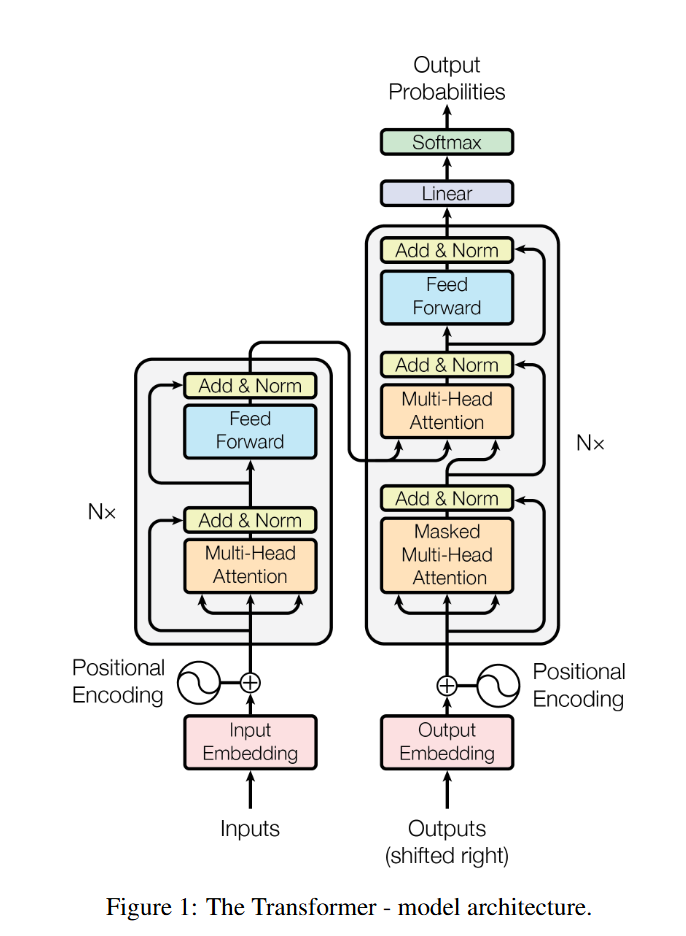
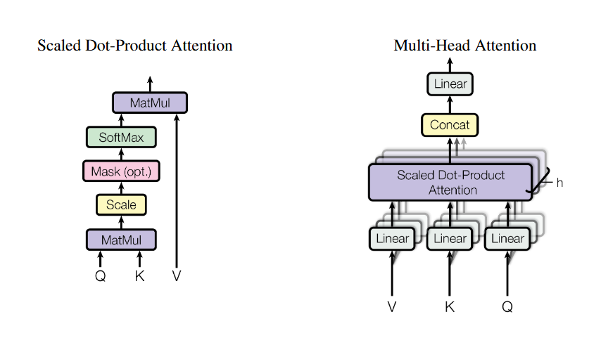
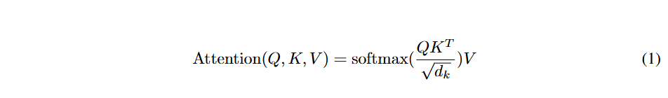
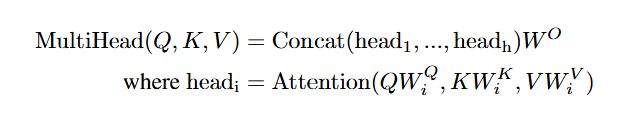
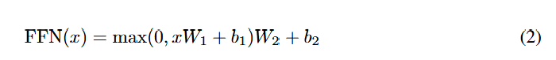
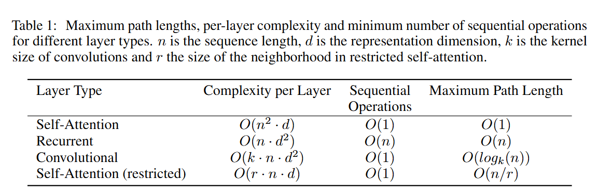
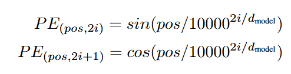
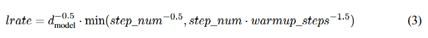
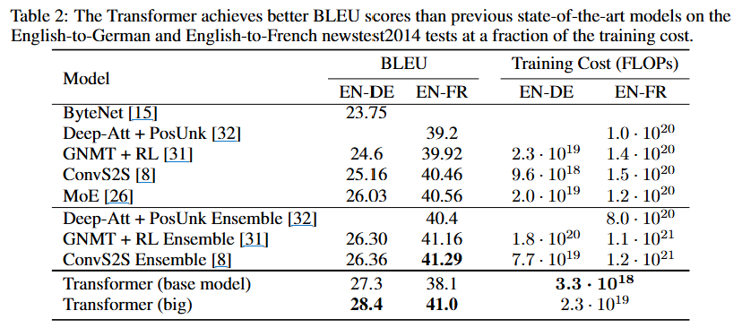
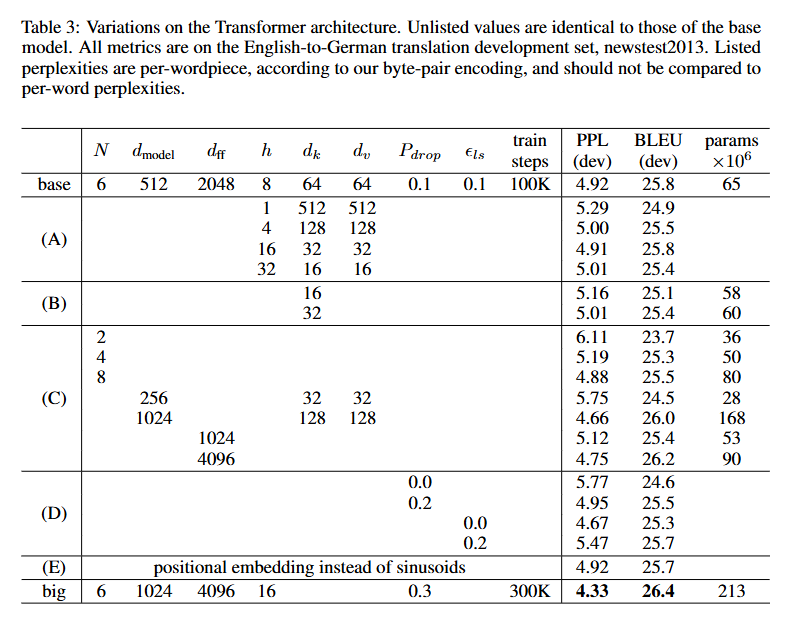

## 선정 이유

대학교 과제 때문에 고등학생들에게 이 논문을 쉽게 한페이지에 담아 설명해야해서 읽게 되었다. 그러나 요즘 LLM이 다 이 논문을 기반으로 돌아가기 때문에 한번쯤은 읽는 것이 LLM을 쓰는 것에 더 도움이 되지 않을까 싶다.

## 제목의 의미

"Attention Is All You Need"를 직역하면 "필요한 건 어텐션뿐이다."이다. 기존 시퀀스 변환 모델들은 인코더와 디코더를 포함하는 복잡한 순환 신경망(RNN)이나 합성곱 신경망(CNN)에 기반을 두고 있으나 이 논문에서는 순환과 합성곱을 배제한 오직 어텐션 메커니즘에만 기반을 둔 모델을 제안하기 때문이다.

### 배경 / 문제 정의

순환 신경망의 본질적인 순차적 특성은 학습 예제 내에서의 병렬화를 불가능하게 하며, 이는 시퀀스 길이가 길어질수록 메모리 제약으로 인해 예제 간 배칭이 제한되므로 매우 중요해진다.

근 연구들은 효율성에서 상당한 개선을 이루었으며 모델 성능 또한 향상시켰으나 순차적 계산이라는 근본적인 제약은 여전히 남아 있다.

### 핵심 아이디어

순환과 합성곱을 완전히 배제하고 오직 어텐션 메커니즘에만 기반을 둔 새롭고 단순한 네트워크 아키텍처인 Transformer를 제안한다.

### 방법론

- Transformer는 멀티 헤드 어텐션(multi-head attention)을 세 가지 다른 방식으로 사용한다.
- 입력 임베딩에 포지셔널 인코딩(positional encodings)을 사용하여 모델이 시퀀스의 순서를 활용할 수 있도록 시퀀스 내 토큰의 상대적 또는 절대적 위치에 대한 정보를 주입한다.

### 실험 및 결과

- 인코더-디코더 아키텍처에서 가장 일반적으로 사용되는 순환 계층(recurrent layers)을 multi-headed self-attention으로 대체하여, 전적으로 어텐션에 기반한 최초의 시퀀스 변환 모델인 Transformer를 제시했다.
- WMT 2014 영어-독일어 번역 작업에서 28.4 BLEU를 달성했다.
- 앙상블을 포함한 기존의 최고 결과들을 2 BLEU 이상 상회하는 성능을 보였다.
- WMT 2014 영어-프랑스어 번역 작업에서 8개의 GPU에서 3.5일간 학습한 후 41.0이라는 새로운 단일 모델 최고 수준의 BLEU 점수를 기록했다.

### 향후 연구 계획

- Transformer를 텍스트 이외의 입력 및 출력 양식을 포함하는 문제로 확장하고, 이미지, 오디오, 비디오와 같은 대규모 입력 및 출력을 효율적으로 처리하기 위해 국소적이고 제한적인 어텐션 메커니즘을 연구할 계획이다.
- 생성 과정을 덜 순차적으로 만드는 것이 당사의 또 다른 연구 목표이다.

### 느낀 점 및 배운 점

요즘 널리 쓰이는 LLM의 전신인 논문을 읽어 봤는데 AES 또한 병렬처리를 위해 CBC가 아닌 CTR을 주로 쓰는 느낌이 아닌가 싶다. 이런걸 공부한 측면에서 순차적인 연산을 병렬적으로 처리한다는 사실에 대해 중요하다고 생각하는데 이 논문이 기존에 있던 순환 신경망의 순차적인 근본적인 문제를 어텐션만을 사용한다는 아이디어로 해결했다는 것이 감명 깊었다. 이전에 ML을 사용해본적이 있는데 확실이 방대한 데이터를 학습하는데에는 많은 시간이 걸린다. 시계열 데이터 학습이 필요해서 LSTM Autoencoder로 학습을 했던 적이 있는데 이 알고리즘은 순차적이여서 굉장히 학습하는데 많은 시간이 걸렸다. 반면 TranAD는 Transfomer기반이라 그런지 굉장히 속도가 빨랐던 기억이 있는데 이 논문을 읽고 그 이유를 알게 된 것 같다.

## 목차별 내용 요약

### Abstract

#### 기존 연구

지배적인 시퀀스 변환 모델들은 인코더와 디코더를 포함하는 복잡한 순환 신경망이나 합성곱 신경망에 기반을 두고 있다. 가장 우수한 성능을 보이는 모델들은 또한 어텐션 메커니즘을 통해 인코더와 디코더를 연결한다.

#### 이 논문의 아이디어

순환과 합성곱을 완전히 배제하고 오직 어텐션 메커니즘에만 기반을 둔 새롭고 단순한 네트워크 아키텍처인 Transformer를 제안한다.

#### 이 논문의 기여

- WMT 2014 영어-독일어 번역 작업에서 28.4 BLEU를 달성했다.
- 앙상블을 포함한 기존의 최고 결과들을 2 BLEU 이상 상회하는 성능을 보였다.
- WMT 2014 영어-프랑스어 번역 작업에서 8개의 GPU에서 3.5일간 학습한 후 41.0이라는 새로운 단일 모델 최고 수준의 BLEU 점수를 기록했다.

### 1 Introduction

- 순환 신경망인 Long Short-Term Memory와 Gated Recurrent 신경망은 언어 모델링 및 기계 번역과 같은 시퀀스 모델링 및 변환 문제에서 최첨단 접근 방식으로 확고히 자리 잡았으며, 이후로 수많은 노력이 순환 언어 모델과 인코더-디코더 아키텍처의 한계를 확장하기 위해 지속되어 왔다.
- 순환 모델(Recurrent models)의 본질적인 순차적 특성은 학습 예제 내에서의 병렬화를 불가능하게 하며, 이는 시퀀스 길이가 길어질수록 메모리 제약으로 인해 예제 간 배칭(batching)이 제한되므로 매우 중요한 문제이다.
- 최근 연구들은 계산 효율성에서 상당한 개선을 이루었으나 순차적 계산이라는 근본적인 제약은 여전히 해결하지 못했다.
- 이 연구에서는 순환을 배제하고 전적으로 어텐션 메커니즘에 의존하여 입력과 출력 사이의 전역적 의존성을 도출하는 모델 아키텍처인 Transformer를 제안한다.
- Transformer는 훨씬 더 많은 병렬화를 가능하게 하며, 8개의 P100 GPU에서 12시간이라는 짧은 학습만으로도 번역 품질 면에서 새로운 최첨단(state of the art) 성능에 도달할 수 있다.

### 2 Background

- 합성곱 신경망(convolutional neural networks, CNN)을 기본 구성 요소로 사용하는 모델들에서 임의의 두 입력 또는 출력 위치의 신호를 연관시키는 데 필요한 연산 수는 위치 간 거리에 따라 증가하며, 이로 인해 먼 위치 간의 의존성을 학습하는 것이 더 어려워진다.
- Transformer에서는 Multi-Head Attention을 통해 상쇄하는 효과인, 어텐션 가중치가 적용된 위치들의 평균화로 인한 유효 해상도 감소라는 대가를 치르기는 하지만, 이를 상수 개의 연산으로 줄였다.

- 자기 어텐션(Self-attention)은 때때로 인트라 어텐션(intra-attention)이라고도 불리며, 시퀀스의 표현을 계산하기 위해 단일 시퀀스의 서로 다른 위치들을 연관시키는 어텐션 메커니즘입니다. 자기 어텐션은 독해, 추상적 요약, 텍스트 함의, 작업 독립적 문장 표현 학습 등 다양한 작업에서 성공적으로 사용되어 왔다.

- Transformer는 시퀀스 정렬 RNN이나 합성곱을 사용하지 않고 전적으로 자기 어텐션에 의존하여 입력과 출력의 표현을 계산하는 최초의 변환 모델이다.

### 3 Model Architecture

Transformer는 그림 1의 왼쪽과 오른쪽에 각각 나타난 바와 같이, 인코더와 디코더 모두에 대해 쌓인 자기 어텐션과 포인트별 완전 연결 층을 사용하여 이러한 전체 아키텍처를 따릅니다.

#### 3.1 Encoder and Decoder Stacks

*Figure 1: The Transformer - model architecture.*

**Encoder:**

- 인코더는 N=6 개의 동일한 층이 쌓여 구성된다. 각 층에는 두 개의 하위 층이 있다.
- 첫 번째는 멀티 헤드 자기 어텐션 메커니즘이고, 두 번째는 간단한 위치별(position-wise) 완전 연결 피드 포워드 네트워크이다.
- 두 개의 하위 계층 각각에 residual connection을 적용하고, 이어서 layer normalization을 수행한다.

**Decoder:**

- 디코더 또한 N = 6개의 동일한 계층이 쌓여 구성된다. 각 인코더 계층에 있는 두 개의 하위 계층과 인코더 스택의 출력에 대해 multi-head attention을 수행하는 세 번째 하위 계층이 있다.
- 인코더와 유사하게, 각 하위 계층 주변에 residual connection을 적용하고 이어서 layer normalization을 수행하며, 디코더 스택의 self-attention 하위 계층을 수정하여 특정 위치가 그 이후의 위치를 참조하지 못하도록 한다.
- 이러한 마스킹은 출력 임베딩이 한 위치만큼 오프셋된다는 사실과 결합되어, 위치 i에 대한 예측이 i보다 작은 위치의 알려진 출력에만 의존할 수 있도록 보장한다.

#### 3.2 Attention

- 어텐션(Attention) 함수는 쿼리(query)와 일련의 키-값(key-value) 쌍을 출력으로 매핑하는 것으로 설명할 수 있으며, 여기서 쿼리, 키, 값, 출력은 모두 벡터이다.
- 출력은 값들의 가중 합으로 계산되며, 각 값에 할당된 가중치는 쿼리와 해당 키의 호환성 함수에 의해 계산된다.

3.2.1 Scaled Dot-Product Attention

*Figure 2: (left) Scaled Dot-Product Attention. (right) Multi-Head Attention consists of several attention layers running in parallel*

- 모든 키(key)와 쿼리(query)를 사용하여 각각을 sqrt{d_k}로 나누고, softmax 함수를 적용하여 값(value)에 대한 가중치를 얻는다.
- 쿼리 집합에 대한 어텐션 함수를 동시에 계산하며, 이를 행렬 Q로 묶습니다. 키와 값 또한 각각 행렬 K와 V로 묶는다.
- 출력 행렬은 다음과 같이 계산한다:

*ompute the matrix of outputs*

- 가장 일반적으로 사용되는 두 가지 어텐션 함수는 additive attention과 dot-product attention이다.
- Dot-product attention은 1/sqrt{d_k} 라는 스케일링 인자를 제외하면 우리의 알고리즘과 동일하다.
- Additive attention은 단일 은닉층(hidden layer)을 가진 피드포워드 네트워크를 사용하여 호환성 함수(compatibility function)를 계산한다.
- 이론적 복잡도 측면에서 두 방식은 유사하지만, dot-product attention은 고도로 최적화된 행렬 곱셈 코드를 사용하여 구현할 수 있기 때문에 실제로는 훨씬 빠르고 공간 효율적이다.
- d_k값이 작을 때는 두 메커니즘의 성능이 비슷하지만, d_k값이 커질수록 스케일링이 없는 dot-product attention보다 additive attention의 성능이 더 뛰어나다.
- d_k값이 커지면 내적(dot product)의 크기가 커져서, softmax 함수가 매우 작은 기울기(gradient)를 가지는 영역으로 밀려나기 때문이라고 추측하기 때문에 이러한 효과를 상쇄하기 위해 내적 값을 1/sqrt{d_k}로 스케일링한다.

3.2.2 Multi-Head Attention

- d_{model} 차원의 키, 값, 쿼리를 사용하여 단일 어텐션 함수를 수행하는 대신, 쿼리, 키, 값을 각각 d_k, d_k, d_v 차원으로 서로 다른 학습된 선형 투영(linear projection)을 통해 h번 선형 투영하는 것이 유익하다는 것을 발견했다.
- 투영된 각 버전의 쿼리, 키, 값에 대해 병렬로 어텐션 함수를 수행하여 d_v차원의 출력 값을 얻는다.
- 이 값들은 Figure 2에 묘사된 바와 같이 연결(concatenate)된 후 다시 한번 투영되어 최종 값을 생성한다.
- Multi-head attention은 모델이 서로 다른 위치에서 서로 다른 표현 부분 공간(representation subspace)의 정보에 공동으로 집중할 수 있게 합니다. 단일 어텐션 헤드(attention head)를 사용할 경우, 평균화가 이를 방해한다.

- 연구에서는 h = 8개의 병렬 어텐션(attention) 계층, 즉 헤드(head)를 사용한다.
- 각 헤드에 대해 d_k = d_v = d_{model}/h = 64를 사용한다.
- 각 헤드의 차원이 축소되었기 때문에, 전체 계산 비용은 전체 차원을 사용하는 단일 헤드 어텐션과 유사하다.

3.2.3 Applications of Attention in our Model

Transformer는 멀티 헤드 어텐션(multi-head attention)을 세 가지 다른 방식으로 사용한다.

1. **"인코더-디코더 어텐션" 계층에서 쿼리(query)는 이전 디코더 계층에서 오며, 메모리 키와 값은 인코더의 출력에서 온다.**  
   이를 통해 디코더의 모든 위치가 입력 시퀀스의 모든 위치를 참조할 수 있다.
2. **인코더는 셀프 어텐션(self-attention) 계층을 포함한다.**  
   셀프 어텐션 계층에서는 모든 키, 값, 쿼리가 동일한 곳, 즉 이 경우에는 인코더의 이전 계층 출력에서 옵니다. 인코더의 각 위치는 인코더의 이전 계층에 있는 모든 위치를 참조할 수 있다.
3. **디코더의 셀프 어텐션 계층은 디코더의 각 위치가 해당 위치를 포함하여 그 이전의 모든 위치를 참조할 수 있도록 한다.**  
   자기 회귀 속성을 유지하기 위해 디코더에서 왼쪽으로의 정보 흐름을 방지해야 합니다. 이를 구현하기 위해 스케일드 닷-프로덕트 어텐션 내부에서 소프트맥스 입력 중 허용되지 않는 연결에 해당하는 모든 값을 마스킹(즉, infty로 설정)한다.

#### 3.3 Position-wise Feed-Forward Networks

어텐션 하위 계층 외에도, 인코더와 디코더의 각 계층은 완전 연결 피드-포워드 네트워크(fully connected feed-forward network)를 포함하며, 이는 각 위치에 개별적이고 동일하게 적용된다. 이는 그 사이에 ReLU 활성화 함수가 있는 두 번의 선형 변환으로 구성된다.

선형 변환은 위치마다 동일하지만, 계층마다 서로 다른 매개변수를 사용한다. 이를 다르게 설명하면 커널 크기가 1인 두 번의 컨볼루션(convolution)으로 볼 수 있다. 입력과 출력의 차원은 d_{model} = 512이며, 내부 계층의 차원은 d_{ff} = 2048다.

#### 3.4 Embeddings and Softmax

- 다른 시퀀스 변환 모델과 유사하게, 학습된 임베딩(embedding)을 사용하여 입력 토큰과 출력 토큰을 d_{model} 차원의 벡터로 변환한하며, 일반적인 학습된 선형 변환과 소프트맥스 함수를 사용하여 디코더 출력을 다음 토큰의 예측 확률로 변환한다.
- 본 모델에서는 두 임베딩 계층과 소프트맥스 이전의 선형 변환 간에 동일한 가중치 행렬을 공유하며, 임베딩 계층에서는 해당 가중치에 sqrt{d_{model}}을 곱한다.

#### 3.5 Positional Encoding

모델은 순환(recurrence)이나 컨볼루션을 포함하지 않으므로, 모델이 시퀀스의 순서를 활용할 수 있도록 시퀀스 내 토큰의 상대적 또는 절대적 위치에 대한 정보를 주입해야 하며 이를 위해 입력 임베딩에 "포지셔널 인코딩(positional encodings)"을 추가한다.

*Table 1: Maximum path lengths, per-layer complexity and minimum number of sequential operations for different layer types. n is the sequence length, d is the representation dimension, k is the kernel size of convolutions and r the size of the neighborhood in restricted self-attention.*

인코더 및 디코더 스택의 하단부. 위치 인코딩(positional encodings)은 임베딩과 동일한 차원 d_{model}을 가지므로 두 값을 더할 수 있다. 학습된 방식과 고정된 방식을 포함하여 위치 인코딩에 대한 많은 선택지가 존재하며, 본 연구에서는 서로 다른 주파수의 사인 및 코사인 함수를 사용한다.

### 4 Why Self-Attention

이 절에서는 가변 길이의 심볼 표현 시퀀스 (x_1, ..., x_n)를 동일한 길이의 다른 시퀀스 (z_1, ..., z_n)로 매핑하는 데 일반적으로 사용되는 순환 및 합성곱 계층과 셀프 어텐션 계층의 다양한 측면을 비교한다.

셀프 어텐션 사용의 동기로서 우리는 세 가지 요구 사항을 고려한다.

1. 계층당 총 계산 복잡도
2. 최소 순차 연산 횟수로 측정되는 병렬화 가능한 계산량
3. 네트워크 내 장기 의존성(long-range dependencies) 사이의 경로 길이

셀프 어텐션 계층은 일정한 수의 순차적 연산으로 모든 위치를 연결하는 반면, 순환 계층은 (O(n)의 순차적 연산을 필요로 한다.

매우 긴 시퀀스를 포함하는 작업의 계산 성능을 향상시키기 위해, 셀프 어텐션은 크기 r인 근방만을 고려하도록 제한될 수 있다.

커널 너비가 k < n인 단일 합성곱(convolutional) 계층은 모든 입력 및 출력 위치 쌍을 연결하지 못한다. 이를 수행하려면 연속적인 커널의 경우 O(n/k)개의 합성곱 계층 스택이 필요하거나, dilated convolution의 경우 O(log_k(n))개의 계층이 필요하며, 이는 네트워크 내 임의의 두 위치 사이의 최장 경로 길이를 증가시킨다.

합성곱 계층은 일반적으로 순환(recurrent) 계층보다 k배 더 많은 비용이 든다. 그러나 separable convolution은 복잡도를 O(k \* n \* d + n \* d^2)로 상당히 감소시킨다. 그럼에도 k = n일 때, separable convolution의 복잡도는 모델에서 취하는 접근 방식인 self-attention 계층과 point-wise feed-forward 계층의 조합과 동일하다.

### 5 Training

이 섹션에서는 모델에 대한 학습 체제를 설명한다.

#### 5.1 Training Data and Batching

- 약 450만 개의 문장 쌍으로 구성된 표준 WMT 2014 영어-독일어 데이터셋으로 학습했다.
- 문장들은 약 37,000개의 토큰으로 구성된 공유 소스-타겟 어휘집을 가진 byte-pair encoding을 사용하여 인코딩되었다.
- 영어-프랑스어의 경우, 3,600만 개의 문장으로 구성된 훨씬 더 큰 WMT 2014 영어-프랑스어 데이터셋을 사용하였으며, 토큰을 32,000개의 word-piece 어휘집으로 분할하였다.
- 문장 쌍들은 대략적인 시퀀스 길이에 따라 배치(batch)로 묶였다.
- 각 학습 배치는 약 25,000개의 소스 토큰과 25,000개의 타겟 토큰을 포함하는 문장 쌍 세트를 포함하였다.

#### 5.2 Hardware and Schedule

- 8개의 NVIDIA P100 GPU가 장착된 한 대의 머신에서 모델을 학습했다.
- 논문 전반에 걸쳐 설명된 하이퍼파라미터를 사용하는 기본 모델의 경우, 각 학습 단계는 약 0.4초가 소요되었다.
- 기본 모델을 총 100,000단계 또는 12시간 동안 학습했다.
- 빅 모델(Table [3](https://www.themoonlight.io/extension/release/3.8.0-f66c1c876765/web/pdf.html?origin=https%3A%2F%2Fmoonlight-paper.s3.ap-northeast-2.amazonaws.com%2Fanonymous%2Ff491c533-78ba-47a2-8d80-5a4b65c76604.pdf&file=blob%3Ahttps%3A%2F%2Fwww.themoonlight.io%2F2412dd11-109f-4b5d-b20a-90af86c5af65&language=ko&paperId=ce5a9bab-3c96-4f17-a71b-0d7aa4defd2e&isPaperOwner=true#table.3)의 맨 아래 줄에 설명됨)의 경우, 단계당 시간은 1.0초였으면, 빅 모델은 300,000단계(3.5일) 동안 학습되었다.

#### 5.3 Optimizer

beta_1 = 0.9, beta_2 = 0.98 및 epsilon = 10^{-9}인 Adam 옵티마이저를 사용했다.

다음 공식에 따라 학습 과정 전반에 걸쳐 학습률을 변경했다.

이는 첫 번째 warmup_steps 학습 단계 동안 학습률을 선형적으로 증가시키고, 그 이후에는 단계 번호의 역제곱근에 비례하여 감소시키는 것에 해당하며, warmup_steps = 4000을 사용했다.

#### 5.4 Regularization

학습 중 3가지 정규화를 사용한다.

**Residual Dropout**

각 하위 계층의 출력에 dropout 을 적용한 후, 이를 하위 계층 입력에 더하고 정규화한다. 또한, 인코더와 디코더 스택 모두에서 임베딩과 위치 인코딩의 합에 dropout을 적용한다. 기본 모델의 경우, P_{drop} = 0.1의 비율을 사용합니다.

*Table 2: The Transformer achieves better BLEU scores than previous state-of-the-art models on the English-to-German and English-to-French newstest2014 tests at a fraction of the training cos*

**Label Smoothing**

학습 과정에서 ls = 0.1 값의 label smoothing을 적용했으며, 이는 모델이 더 불확실한 상태를 학습하게 되어 perplexity에는 부정적인 영향을 미치지만, 정확도와 BLEU 점수는 향상시킨다.

### 6 Results

#### 6.1 Machine Translation

- WMT 2014 영어-독일어 번역 작업에서, 대형 Transformer 모델은 이전에 보고된 최고의 모델들(앙상블 포함)보다 2.0 BLEU 이상 뛰어난 성능을 보이며 28.4라는 새로운 최첨단 BLEU 점수를 기록했다.
- WMT 2014 영어-프랑스어 번역 작업에서, 우리의 대형 모델은 41.0의 BLEU 점수를 달성했다.

Table 2는 결과를 요약하고, 문헌에 제시된 다른 모델 아키텍처들과 번역 품질 및 학습 비용을 비교한다.

#### 6.2 Model Variations

- Transformer의 다양한 구성 요소의 중요성을 평가하기 위해, 기본 모델을 여러 방식으로 변경하며 개발 세트인 newstest2013에서의 영어-독일어 번역 성능 변화를 측정하였다.
- 단일 헤드 어텐션은 최적 설정보다 0.9 BLEU만큼 성능이 낮으며, 헤드 수가 너무 많아져도 품질이 저하되는 것으로 나타난다.

*Table 3: Variations on the Transformer architecture. Unlisted values are identical to those of the base model. All metrics are on the English-to-German translation development set, newstest2013. Listed perplexities are per-wordpiece, according to our byte-pair encoding, and should not be compared to per-word perplexities.*

- Table 3의 (B) 행에서, 어텐션 키 크기 d_k를 줄이는 것이 모델 품질을 저하시킨다는 점을 확인했다. 이는 호환성을 결정하는 것이 쉽지 않으며, 내적(dot product)보다 더 정교한 호환성 함수가 유용할 수 있음을 시사한다.
- (C) 및 (D) 행에서 예상대로 더 큰 모델이 더 우수하며, dropout이 과적합(over-fitting)을 방지하는 데 매우 유용하다는 점을 확인했다.
- (E) 행에서는 sinusoidal positional encoding을 학습된 positional embedding으로 대체하였으며, 기본 모델과 거의 동일한 결과를 확인했다.

### 7 Conclusion

#### 결론

- 본 연구에서는 인코더-디코더 아키텍처에서 가장 일반적으로 사용되는 순환 계층(recurrent layers)을 multi-headed self-attention으로 대체하여, 전적으로 어텐션에 기반한 최초의 시퀀스 변환 모델인 Transformer를 제시했다.
- 번역 작업의 경우, WMT 2014 영어-독일어 및 WMT 2014 영어-프랑스어 번역 작업 모두에서 새로운 최첨단(state of the art) 성능을 달성했다. 전자의 작업에서 당사의 최적 모델은 이전에 보고된 모든 앙상블 모델보다 뛰어난 성능을 보인다.

#### 향후 계획

Transformer를 텍스트 이외의 입력 및 출력 양식을 포함하는 문제로 확장하고, 이미지, 오디오, 비디오와 같은 대규모 입력 및 출력을 효율적으로 처리하기 위해 국소적이고 제한적인 어텐션 메커니즘을 연구할 계획이며, 생성 과정을 덜 순차적으로 만드는 것이 당사의 또 다른 연구 목표이다.

모델을 학습하고 평가하는 데 사용한 코드는 [https](https://github.com/tensorflow/tensor2tensor)://github.com/tensorflow/tensor2tensor 에서 확인할 수 있습니다.
